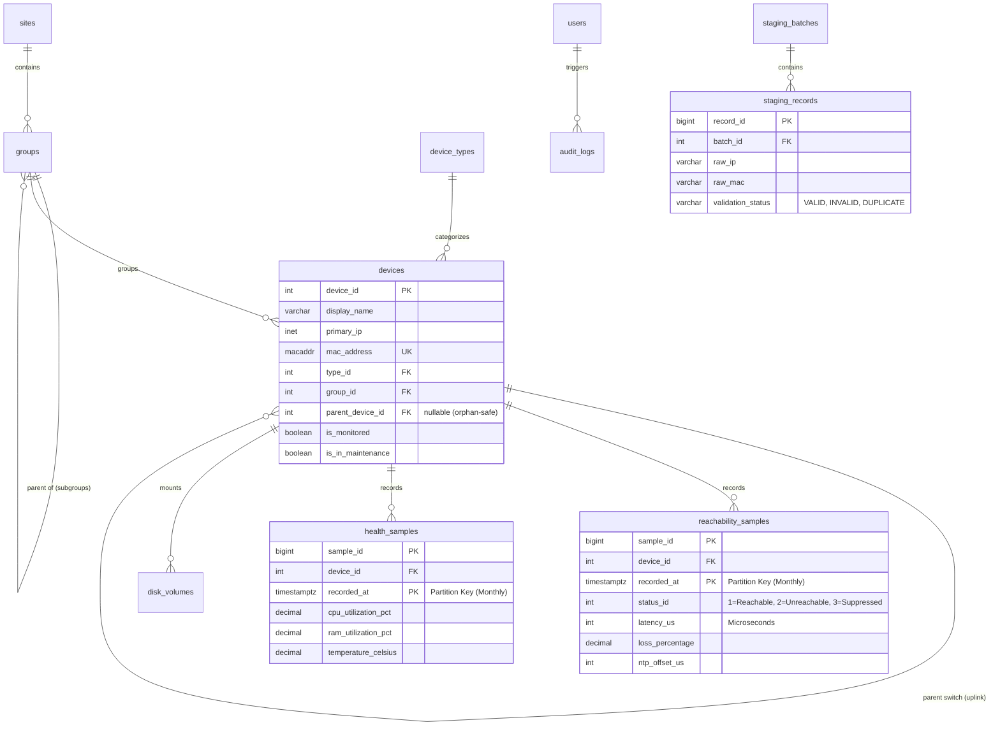

# 📡 Network Observer — Industrial LAN Telemetry & Topology Platform

[-512BD4?style=for-the-badge&logo=dotnet&logoColor=white)](https://dotnet.microsoft.com/)
[-4169E1?style=for-the-badge&logo=postgresql&logoColor=white)](https://www.postgresql.org/)
[-4FC08D?style=for-the-badge&logo=vuedotjs&logoColor=white)](https://vuejs.org/)
[](https://vitejs.dev/)
[-06B6D4?style=for-the-badge&logo=tailwindcss&logoColor=white)](https://tailwindcss.com/)
[](backend/tests/NetworkObserver.Tests)
[](docs/security_and_rbac_specification.md)
[](docs/software_architecture_and_libraries_specification.md)

---

## ⚡ The "Vibecoded" Story

> **"I dictated the requirements, architecture, tech stack, database schema, and operational constraints. My AI partner (Antigravity) wrote 100% of the production code."**

This project is a showcase of high-velocity, precision **vibecoding** — pairing human domain architecture and system vision with autonomous agentic code execution. 

```mermaid
flowchart LR
    subgraph Human["🧑‍💻 Human Architect (The Vibecoder)"]
        direction TB
        A["Product Requirements & PRD/SRS"]
        B["4-Tier Clean Architecture Doctrine"]
        C["Relational 3NF PostgreSQL Schema"]
        D["Air-Gapped & <500MB Memory Budget"]
        E["Cyber-Tactical UX & Dual Topology Canvas"]
        F["Iterative Code Review & Edge Case Steering"]
    end

    subgraph Agent["🤖 AI Coding Muscle (Antigravity)"]
        direction TB
        G["100% Production Codebase"]
        H[".NET 10 Kestrel Web API & EF Core 10"]
        I["Vue 3 + Vite + Tailwind + Pinia Frontend"]
        J["Concurrent ICMP Ping Engine & Cascade Suppression"]
        K["Coordinate-Anchored Canvas Pan/Zoom Math"]
        L["151 Automated Unit & Integration Tests (100% Pass)"]
    end

    Human ==>|Dictates Specs, Invariants & Guidance| Agent
    Agent ==>|Delivers Compiling, Verified Fullstack System| Human
```



### The Division of Labor
| Responsibility Tier | The Vibecoder (Human Architect) | Antigravity (AI Pair Programmer) |
| :--- | :--- | :--- |
| **System Vision** | Conceived an air-gapped, sub-millisecond LAN telemetry & topology platform for university computer labs and restricted enterprise enclaves. | Translated domain constraints into working software specifications and implementations. |
| **Architecture & Invariants** | Mandated 4-Tier Clean Architecture, Inviolable Boundary Rules (Zero `DbContext` in Controllers), Zero Raw SQL LINQ policy, and <500 MB RAM budget. | Scaffolded the entire C# solution, designed domain interfaces, implemented clean repositories, services, and DTOs. |
| **Database Design** | Hand-crafted the 3NF relational schema, declarative monthly range partitioning, PL/pgSQL triggers, and orphan-safe foreign keys. | Wrote DDL migrations, EF Core model mappings, entity configurations, and transactional staging ingestion logic. |
| **User Experience** | Dictated the Cyber-Tactical dark theme, Dual Topology views (Functional Lab hierarchy vs. Pure Device-to-Device), HUD metrics, and Slide-over Inspector. | Authored all Vue 3 SFCs, Tailwind classes, coordinate-anchored pan/zoom trigonometry, and Pinia stores. |
| **Quality & Hardening** | Set strict acceptance criteria, caught cascade suppression edge cases, and guided bugfixes (e.g., ID 0 boundary guards). | Wrote all 151 unit tests across domain logic, services, and auth; executed zero-warning builds and runtime verification. |

---

## 🧭 Executive Summary & Core Mission

In mission-critical academic computer labs, industrial SCADA setups, and air-gapped research enclaves:
1. **Cloud-managed agents** (Datadog, Dynatrace, AWS CloudWatch) are strictly prohibited due to air-gap isolation and telemetry exfiltration risks.
2. **Legacy on-prem tools** (Nagios, Zabbix) are heavyweight, require complex local daemons on every single PC, and consume gigabytes of host RAM.
3. **Network outages** cascade downstream, triggering noisy alert floods that obscure the real root cause (e.g., an upstream core switch failure reports hundreds of PCs as down).

**Network Observer** solves this with an **agentless, sub-millisecond ICMP telemetry engine** coupled with an **interactive topological canvas**, running entirely on a single lightweight workstation or server with a strict **500 MB RAM budget** and **zero internet dependencies**.

---

## 🌟 Key Capabilities & Features

### 1. ⚡ Agentless Sub-Millisecond ICMP Telemetry Engine
- **High-Throughput Ping Engine**: Background worker throttles async ICMP sweeps across hundreds of monitored workstations and networking equipment.
- **Cascade Failure Suppression**: If an upstream router or switch drops, downstream computers are marked `UNREACHABLE` without false root-cause alerts or metric contamination.
- **Strict N/A Metric Rule**: When a device is unreachable, real-time metrics (RTT latency, packet loss, CPU, RAM) are strictly rendered as `NULL / N/A` rather than showing stale or zeroed data.

### 2. 🗺️ Dual-Mode Interactive Topology Canvas
- **Mode 1 — Computer Lab Functional Hierarchy**:
  - `Core Gateway` $\rightarrow$ `Aggregate Switch` $\rightarrow$ `Computer Lab Groups (Lab A, Lab B)` $\rightarrow$ `Connected Workstations`.
  - Group cards display live health statistics (e.g., *24 Total, 22 Online, 2 Offline*).
- **Mode 2 — Pure Device-to-Device Physical Interconnects**:
  - Direct parent-child link visualization without intermediate group boxes, highlighting physical patch links.
- **Natural Cursor-Anchored Pan & Zoom**: Custom mathematical canvas anchoring pins world coordinates under the mouse cursor during scroll wheel zoom, avoiding jarring top-left drift.

### 3. 📊 Cyber-Tactical Operational HUD & Diagnostics Drawer
- **Minimalist Top Banner**: Real-time fleet counters for *Total Monitored*, *Reachable (Online)*, *Unreachable (Offline)*, *Maintenance*, and *Degraded*.
- **Slide-Over Telemetry Inspector**: Click any device in the canvas or inventory table to slide out an in-depth hardware diagnostics drawer:
  - Sub-millisecond round-trip time (RTT in $\mu$s / ms)
  - Microsecond-accurate NTP time offset ($\pm\mu$s)
  - Packet loss percentage
  - CPU & RAM utilization gauges
  - Mounted disk volumes & storage capacity
  - One-click *Diagnostic Freeze / Maintenance Mode* toggle with operator audit notes.

### 4. 📥 Two-Phase Bulk Staging Ingestion Engine
- Safe, non-destructive equipment onboarding:
  - **Phase 1 (Staging & Validation)**: Upload raw CSV or JSON device dumps into isolated staging tables. The engine parses MAC formats, IP validity, and detects subnet conflicts without touching production tables.
  - **Phase 2 (Atomic Batch Commit)**: Commits clean records inside a transactional database boundary while automatically linking parent-child switch relationships.

### 5. 🛡️ Air-Gapped Security & Enterprise RBAC
- **Argon2id Passphrase Hashing**: Modern, memory-hard password derivation via `Isopoh.Cryptography.Argon2`.
- **Constant-Time Verification**: Prevents side-channel timing attacks.
- **Role-Based Access Control**:
  - `NetworkAdmin` (Full system governance, user provisioning, equipment deletion)
  - `NetworkEngineer` (Topology configuration, subnet sweeps, maintenance overrides)
  - `ItSupport` (Device inspection, operational triage)
  - `Auditor` (Read-only historical access)
- **Zero External CDNs**: All fonts, icons (Lucide SVG), and stylesheets are packaged locally within the frontend bundle.

### 6. 📜 Immutable Append-Only Audit Logging
- Every single state change (device created, edited, maintenance toggled, user logged in/out) is written to an immutable audit table with the operator ID, IP address, timestamp, and a full previous/current JSON state diff.

---

## 🏛️ System Architecture

Network Observer follows a strict **4-Tier Clean Architecture** governed by unbreakable engineering rules.

```
┌────────────────────────────────────────────────────────┐
│             Presentation Tier: Vue 3 SPA              │
│       (Vite, Tailwind CSS, Pinia, Lucide Icons)        │
└───────────────────────────▲────────────────────────────┘
                            │ HTTP REST / JSON Cookies
┌───────────────────────────▼────────────────────────────┐
│         API Tier: NetworkObserver.Api (.NET 10)         │
│  Controllers, Session Middleware, RBAC Filters, Swagger│
└───────────────────────────▲────────────────────────────┘
                            │ Inviolable Boundary (Zero DbContext)
┌───────────────────────────▼────────────────────────────┐
│   Application Tier: NetworkObserver.Application        │
│   Services, Interfaces, DTOs, FluentValidation         │
└───────────────────────────▲────────────────────────────┘
                            │ Dependency Inversion
┌───────────────────────────▼────────────────────────────┐
│   Infrastructure Tier: NetworkObserver.Infrastructure  │
│   EF Core 10, Repositories, Background Ping Worker     │
└───────────────────────────▲────────────────────────────┘
                            │ Domain Entities
┌───────────────────────────▼────────────────────────────┐
│        Domain Tier: NetworkObserver.Domain             │
│        Entities, Value Objects, Domain Exceptions      │
└────────────────────────────────────────────────────────┘
```

### Inviolable Architectural Principles
1. **The Inviolable Boundary Rule**: Controllers **never** inject `DbContext`. All business operations strictly flow through `IApplicationService` and domain repository interfaces.
2. **Zero Raw SQL Policy**: 100% of queries use EF Core LINQ with explicit projection (`.Select()`) to eliminate N+1 queries and guarantee compile-time type safety.
3. **Memory Ceiling (< 500 MB RAM)**:
   - EF Core tracking is disabled on all read queries (`AsNoTracking()`).
   - Telemetry batches are streamed and disposed after persistence.
   - Frontend leverages fine-grained Vue reactivity (`shallowRef` for telemetry streams and `markRaw` for canvas state).
   - Production working set verified at **~265 MB RAM**.

---

## 🗄️ Relational Database Schema (3NF)

PostgreSQL 18 is configured with strict 3NF normalization, declarative range partitioning, and orphan-safe foreign keys.



> [!NOTE]
> High-frequency telemetry tables (`reachability_samples` and `health_samples`) are **monthly range-partitioned** by `recorded_at`. This allows queries over millions of samples to execute in sub-milliseconds via PostgreSQL partition pruning.

---

## 🛠️ Technology Stack Matrix

| Layer | Component | Version | Selection Rationale |
| :--- | :--- | :--- | :--- |
| **Backend Runtime** | .NET (C#) | 10.0 | High-performance asynchronous Kestrel runtime, native memory efficiency, strong typing. |
| **ORM / Data Access** | EF Core + Npgsql | 10.0 | High-speed PostgreSQL driver with native support for `inet` and `macaddr` types. |
| **Database** | PostgreSQL | 18.3 | Declarative monthly table partitioning, robust PL/pgSQL triggers, rock-solid ACID reliability. |
| **Cryptography** | Isopoh.Cryptography.Argon2 | 2.0 | Memory-hard Argon2id key derivation resisting GPU/ASIC brute-force attacks. |
| **Validation** | FluentValidation | 11.11 | Declarative validation rules separated cleanly from domain entities. |
| **Frontend Framework** | Vue.js | 3.5 | Modern Composition API (`<script setup lang="ts">`), optimal bundle size, lightning reactivity. |
| **Frontend Build Tool** | Vite | 5.4 | Sub-second HMR and optimized production Rollup chunks. |
| **Styling** | Tailwind CSS | 3.4 | Custom Cyber-Tactical dark palette, utility-first design without runtime CSS bloat. |
| **State Management** | Pinia | 2.3 | Modular, strongly-typed stores for devices, groups, discovery, and auth state. |
| **Icons** | Lucide Vue Next | 1.16 | Lightweight, customizable SVG icons bundled directly into the application. |
| **Test Framework** | xUnit + Moq + FluentAssertions | Latest | 151 comprehensive unit and integration tests verifying domain invariants and services. |

---

## 🚀 Getting Started & Local Setup

### Prerequisites
- [.NET 10.0 SDK](https://dotnet.microsoft.com/)
- [Node.js 20+ & npm](https://nodejs.org/)
- [PostgreSQL 18+](https://www.postgresql.org/) (Running on `localhost:5432`)

### 1. Database Initialization
Create the database and apply the 3NF schema:
```powershell
# Create database
psql -U postgres -c "CREATE DATABASE network_observer;"

# Execute master schema & pre-seeded data
psql -U postgres -d network_observer -f "sql/001_initial_schema.sql"
```

### 2. Configure Backend
Review `backend/src/NetworkObserver.Api/appsettings.json` to verify database connection settings:
```json
{
  "ConnectionStrings": {
    "DefaultConnection": "Host=localhost;Port=5432;Database=network_observer;Username=postgres;Password=YOUR_POSTGRES_PASSWORD"
  }
}
```

### 3. Build & Run Backend
```powershell
# Restore & run Kestrel Web API
dotnet run --project backend/src/NetworkObserver.Api/NetworkObserver.Api.csproj --urls "http://localhost:5000"
```

### 4. Build & Launch Frontend
In a separate terminal:
```powershell
cd frontend
npm install
npm run dev
```
The Vite development server will start on `http://localhost:5173` with automatic API proxying to `http://localhost:5000`.

Alternatively, compile for production and serve directly through Kestrel:
```powershell
cd frontend
npm run build
# Dist assets are automatically served from http://localhost:5000
```

### 5. Default Operator Credentials
| Field | Value |
| :--- | :--- |
| **Username** | `admin` |
| **Password** | `Admin@NetworkObserver2026!` |
| **Assigned Role** | `NetworkAdmin` (Tier 1 Full Governance) |

---

## 🧪 Automated Test Suite

All 151 unit and integration tests are organized cleanly in `backend/tests/NetworkObserver.Tests`:

```powershell
dotnet test backend/tests/NetworkObserver.Tests/NetworkObserver.Tests.csproj
```

```
Test run for NetworkObserver.Tests.dll (.NETCoreApp,Version=v10.0)
Passed!  - Failed: 0, Passed: 151, Skipped: 0, Total: 151, Duration: 24 s
```

### Test Coverage Highlights
- ✅ **Domain Invariants**: MAC address immutability, IP format validations, group hierarchy circularity guards.
- ✅ **Cascade Failure Suppression**: Upstream node failure correctly marks downstream workstations as `UNREACHABLE` without false alarms.
- ✅ **Telemetry Ingestion**: Dry-run validation rules, MAC collision checks, atomic staging batch commit behavior.
- ✅ **Argon2id Authentication**: Password hashing, constant-time verification, session expiration, and role enforcement.
- ✅ **Maintenance Mode**: State transitions, telemetry freeze behavior, audit log trail generation.

---

## 📂 Project Directory Structure

```
Network monitor/
├── backend/
│   ├── src/
│   │   ├── NetworkObserver.Domain/           # Core Entities, Enums, Value Objects
│   │   ├── NetworkObserver.Application/      # Services, DTOs, Repository Interfaces
│   │   ├── NetworkObserver.Infrastructure/   # EF Core DbContext, Repositories, Ping Worker
│   │   └── NetworkObserver.Api/              # Controllers, Session Auth, Middleware, wwwroot
│   └── tests/
│       └── NetworkObserver.Tests/            # 151 xUnit / Moq / FluentAssertions Unit Tests
├── frontend/
│   ├── src/
│   │   ├── api/                              # Axios client & typed API wrappers
│   │   ├── components/common/                # Badges, Modals, Headers, Reusable Widgets
│   │   ├── features/
│   │   │   ├── auth/                         # Login view, password change modal
│   │   │   ├── discovery/                    # CIDR sweep & host import view
│   │   │   ├── inventory/                    # 1:1 Schema device table & modals
│   │   │   ├── settings/                     # Enclave settings, site/group managers
│   │   │   ├── telemetry/                    # HUD banner, slide-over telemetry inspector
│   │   │   ├── topology/                     # Dual-mode tree canvas & pan/zoom logic
│   │   │   └── users/                        # User management & RBAC governance
│   │   ├── stores/                           # Pinia reactive state stores
│   │   └── types/                            # TypeScript interfaces matching backend DTOs
│   ├── index.html
│   ├── package.json
│   ├── tailwind.config.js
│   └── vite.config.ts
├── docs/                                     # Master Specifications (PRD, SRS, Architecture, DB DDL)
├── sql/
│   └── 001_initial_schema.sql                # Complete 3NF PostgreSQL DDL script
├── NetworkObserver.slnx                      # Root .NET Solution File
└── README.md                                 # Master Project Documentation
```

---

## ⚖️ License & Intellectual Property

Engineered as a high-integrity, air-gapped network operations platform. Built via the human-architected, AI-implemented **vibecoding** paradigm. All rights reserved.
