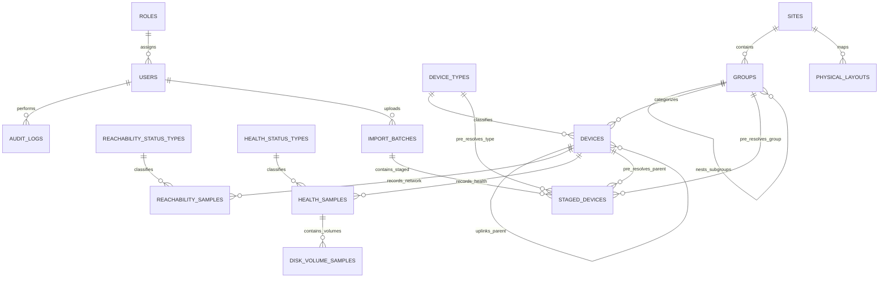
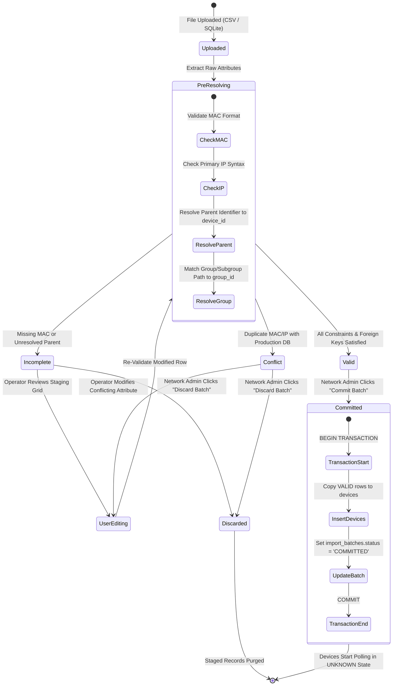

# Database Schema & Data Ingestion Specification
## System: Network Observer — Industrial LAN Telemetry & Topology Management Platform

**Document Version:** 2.1 (Fully Harmonized 3NF Specification)  
**Date:** 15 October 2026  
**Status:** Approved Master Baseline  
**Architecture Standard:** Strictly Level 3 Normalized (3NF) Relational Architecture on PostgreSQL 15+  
**Engine & Optimization:** Multi-Version Concurrency Control (MVCC) with Native Range-Partitioned Time-Series  
**Specification Boundary:** PostgreSQL 15+ SQL DDL, Declarative Partitioning, and Relational Logic.

---

## 1. Executive Summary & Design Principles

This document establishes the definitive 3NF database schema, time-series ingestion pipeline, and physical layout data contracts for **Network Observer**. It resolves all architectural ambiguities across multi-tenancy scoping, organizational nesting, hardware identity, persistent file staging, and telemetry sample nullability.

### Core Architectural Guarantees
1. **Strict 3NF Compliance**: Every non-key column is strictly dependent on the primary key, the whole primary key, and nothing but the primary key. Redundant string storage is eliminated via normalized status/type lookup tables.
2. **Site-Scoped Single Enclave**: Built with a normalized `sites` entity pre-seeded with a default site (`site_id = 1`), supporting seamless multi-site expansion in future versions without breaking relational constraints.
3. **Unified Self-Referencing Group Hierarchy**: Groups and Subgroups are unified in a single `groups` table with `parent_group_id`. Arbitrary nesting depth is supported without creating artificial duplicate tables.
4. **MAC-Centric Hardware Identity**: `devices.mac_address` serves as the immutable, unique hardware key. Primary IP addresses remain mutable operational attributes.
5. **Strict "Never Zero for Missing Data" (N/A) Guarantees**: `reachability_samples.latency_us` and `reachability_samples.ntp_offset_us` are nullable (`NULL`), ensuring timed-out or unsupported metrics are stored as `NULL` and rendered as `N/A`, never distorted as 0.
6. **Persistent Industrial Ingestion Pipeline**: Staged imports are persisted in `import_batches` and `staged_devices`. Uncommitted uploads survive browser crashes or system restarts. Only rows with `validation_status = 'VALID'` are committed to production.
7. **Spatial JSON Layout Decoupling**: Database stores layout registrations and filesystem paths; spatial $(X, Y)$ coordinate matrices remain entirely inside self-contained JSON layout files.
8. **Absolute Single Source of Truth Mandate**: The relational entities, DDL structures, ingestion rules, and constraints documented herein are immutable architectural contracts. Any schema divergence not documented must be halted with: *"I cannot trace this back to the document / It contradicts the document"*. Specifications must be formally revised and approved first before any schema or DDL modifications proceed.

---

## 2. Complete Entity-Relationship Model (3NF)



---

## 3. Physical Layout Spatial JSON Specification

> [!NOTE]
> **Implementation Lifecycle Status: Planned for Future Development (Milestone 2)**  
> The physical spatial layout JSON schema and `physical_layouts` database DDL are established and frozen herein to guarantee architectural stability and future expansion without schema refactoring. Active implementation in the Phase 1 MVP focuses 100% on the core Logical Topology Tree.

To guarantee zero database schema bloat and infinite rendering flexibility, physical floorplan placements are decoupled from relational tables and stored in self-contained JSON layout files.

### 3.1 JSON Schema Contract (`layout_schema.json`)
```json
{
  "$schema": "https://json-schema.org/draft/2020-12/schema",
  "title": "PhysicalSpatialLayout",
  "type": "object",
  "required": ["layout_id", "site_id", "floor_name", "canvas_dimensions", "background_image", "nodes"],
  "properties": {
    "layout_id": { "type": "string", "description": "Unique alphanumeric layout slug" },
    "site_id": { "type": "integer", "description": "Foreign key reference to sites table" },
    "floor_name": { "type": "string", "description": "Human-readable layout name (e.g., '1st Floor Server Lab')" },
    "canvas_dimensions": {
      "type": "object",
      "required": ["width", "height"],
      "properties": {
        "width": { "type": "integer", "minimum": 100 },
        "height": { "type": "integer", "minimum": 100 }
      }
    },
    "background_image": {
      "type": "string",
      "description": "Relative URI to high-resolution architectural SVG/PNG floorplan"
    },
    "nodes": {
      "type": "array",
      "items": {
        "type": "object",
        "required": ["device_id", "mac_address", "x", "y"],
        "properties": {
          "device_id": { "type": "integer" },
          "mac_address": { "type": "string", "pattern": "^([0-9A-Fa-f]{2}[:-]){5}([0-9A-Fa-f]{2})$" },
          "x": { "type": "number", "description": "X coordinate in canvas pixels" },
          "y": { "type": "number", "description": "Y coordinate in canvas pixels" },
          "custom_label": { "type": "string" },
          "render_scale": { "type": "number", "default": 1.0 }
        }
      }
    }
  }
}
```

---

## 4. Standardized SQL DDL (PostgreSQL 15+ 3NF Master Implementation)

The following DDL establishes the complete schema for **PostgreSQL 15+**. All data types, timezone-aware timestamps (`TIMESTAMPTZ`), range-partitioned time-series tables, foreign keys, and PL/pgSQL immutability triggers are explicitly defined.

```sql
-- ============================================================================
-- 1. MULTI-TENANCY SCOPE & ORGANIZATIONAL HIERARCHY
-- ============================================================================

-- Scoped Site entity (Pre-seeded with Site 1 for single-enclave installations)
CREATE TABLE sites (
    site_id SERIAL PRIMARY KEY,
    site_name VARCHAR(100) NOT NULL UNIQUE,
    facility_code VARCHAR(50),
    description TEXT,
    created_at TIMESTAMPTZ DEFAULT CURRENT_TIMESTAMP NOT NULL,
    updated_at TIMESTAMPTZ DEFAULT CURRENT_TIMESTAMP NOT NULL
);

-- Pre-seed default site for single-site deployment
INSERT INTO sites (site_id, site_name, facility_code, description) 
VALUES (1, 'Primary Site Enclave', 'SITE-01', 'Default industrial LAN facility');

-- Unified Self-Referencing Groups & Subgroups Hierarchy (3NF Compliant)
CREATE TABLE groups (
    group_id SERIAL PRIMARY KEY,
    site_id INTEGER NOT NULL DEFAULT 1,
    parent_group_id INTEGER,                     -- NULL for top-level Groups; Non-NULL for Subgroups
    group_name VARCHAR(100) NOT NULL,
    description TEXT,
    created_at TIMESTAMPTZ DEFAULT CURRENT_TIMESTAMP NOT NULL,
    
    CONSTRAINT fk_group_site FOREIGN KEY (site_id) 
        REFERENCES sites(site_id) ON DELETE RESTRICT,
    CONSTRAINT fk_group_parent FOREIGN KEY (parent_group_id) 
        REFERENCES groups(group_id) ON DELETE CASCADE,
    CONSTRAINT uq_site_group_name UNIQUE (site_id, parent_group_id, group_name)
);

-- Pre-seed system fallback group (ID = 1 is reserved for Unassigned assets)
INSERT INTO groups (group_id, site_id, parent_group_id, group_name, description) 
VALUES (1, 1, NULL, 'Unassigned Group', 'System pool for unclassified devices and orphans');

CREATE INDEX idx_groups_parent ON groups(parent_group_id);
CREATE INDEX idx_groups_site ON groups(site_id);

-- ============================================================================
-- 2. HARDWARE INVENTORY & 4-TIER NETWORK TOPOLOGY
-- ============================================================================

-- Normalized Device Classifications
CREATE TABLE device_types (
    type_id SMALLSERIAL PRIMARY KEY,
    type_code VARCHAR(30) NOT NULL UNIQUE        -- 'CORE_ROUTER', 'AGGREGATE_SWITCH', 'ACCESS_SWITCH', 'SERVER', 'PC'
);

INSERT INTO device_types (type_id, type_code) VALUES 
(1, 'CORE_ROUTER'),
(2, 'AGGREGATE_SWITCH'),
(3, 'ACCESS_SWITCH'),
(4, 'SERVER'),
(5, 'PC');

-- Master Devices Table (Immutable MAC, Mutable IP, Adjacency Tree)
CREATE TABLE devices (
    device_id SERIAL PRIMARY KEY,
    mac_address VARCHAR(17) NOT NULL UNIQUE,      -- Immutable Hardware Key (XX:XX:XX:XX:XX:XX)
    primary_ip VARCHAR(45) NOT NULL,              -- Mutable IPv4/IPv6 address
    display_name VARCHAR(150) NOT NULL,
    type_id SMALLINT NOT NULL,
    group_id INTEGER NOT NULL DEFAULT 1,          -- Defaults to Unassigned Group (1)
    parent_device_id INTEGER,                     -- Self-referencing link: Uplink parent switch/router
    zone VARCHAR(100),                            -- Physical zone (e.g. "Rack B", "Control Room")
    vendor VARCHAR(100),                          -- Hardware vendor inferred from MAC OUI
    model VARCHAR(100),                           -- Model identifier
    is_monitored BOOLEAN DEFAULT TRUE NOT NULL,   -- Polling toggle
    created_at TIMESTAMPTZ DEFAULT CURRENT_TIMESTAMP NOT NULL,
    updated_at TIMESTAMPTZ DEFAULT CURRENT_TIMESTAMP NOT NULL,
    
    CONSTRAINT fk_device_type FOREIGN KEY (type_id) 
        REFERENCES device_types(type_id) ON DELETE RESTRICT,
    CONSTRAINT fk_device_group FOREIGN KEY (group_id) 
        REFERENCES groups(group_id) ON DELETE SET DEFAULT,
    CONSTRAINT fk_device_parent FOREIGN KEY (parent_device_id) 
        REFERENCES devices(device_id) ON DELETE SET NULL
);

CREATE INDEX idx_devices_ip ON devices(primary_ip);
CREATE INDEX idx_devices_mac ON devices(mac_address);
CREATE INDEX idx_devices_parent ON devices(parent_device_id);
CREATE INDEX idx_devices_group ON devices(group_id);
CREATE INDEX idx_devices_monitored ON devices(is_monitored);

-- ============================================================================
-- 3. NETWORK REACHABILITY & TIME-SERIES SAMPLES (PARTITIONED)
-- ============================================================================

-- Global Polling Engine & Monitoring Configuration
CREATE TABLE monitoring_config (
    config_id INTEGER PRIMARY KEY DEFAULT 1,
    site_id INTEGER NOT NULL DEFAULT 1,
    reachability_interval_sec INTEGER NOT NULL DEFAULT 5,       -- ICMP & NTP check cadence (seconds)
    reachability_timeout_ms INTEGER NOT NULL DEFAULT 2000,      -- ICMP echo reply timeout (milliseconds)
    health_interval_sec INTEGER NOT NULL DEFAULT 30,             -- Host telemetry polling cadence (seconds)
    health_timeout_ms INTEGER NOT NULL DEFAULT 5000,             -- Host agent HTTP/SNMP timeout (milliseconds)
    cascade_suppression_enabled BOOLEAN NOT NULL DEFAULT TRUE,  -- TRUE = halt downstream pings on switch failure
    updated_at TIMESTAMPTZ DEFAULT CURRENT_TIMESTAMP NOT NULL,
    
    CONSTRAINT fk_mon_config_site FOREIGN KEY (site_id)
        REFERENCES sites(site_id) ON DELETE RESTRICT,
    CONSTRAINT chk_mon_config_single_row CHECK (config_id = 1)  -- Enforces singleton configuration
);

-- Pre-seed default monitoring configuration
INSERT INTO monitoring_config (config_id, site_id, reachability_interval_sec, reachability_timeout_ms, health_interval_sec, health_timeout_ms, cascade_suppression_enabled)
VALUES (1, 1, 5, 2000, 30, 5000, TRUE);

-- Normalized Reachability Status Lookup
CREATE TABLE reachability_status_types (
    status_id SMALLINT PRIMARY KEY,
    status_code VARCHAR(30) NOT NULL UNIQUE      -- 'UNKNOWN', 'REACHABLE', 'UNREACHABLE', 'SUPPRESSED'
);

INSERT INTO reachability_status_types (status_id, status_code) VALUES 
(0, 'UNKNOWN'),
(1, 'REACHABLE'),
(2, 'UNREACHABLE'),
(3, 'SUPPRESSED');

-- Time-Series Reachability Telemetry (Declaratively Partitioned by Range on recorded_at)
-- NOTE: latency_us and ntp_offset_us are NULLABLE to satisfy the Strict N/A (Never Zero) rule.
CREATE TABLE reachability_samples (
    sample_id BIGSERIAL,
    device_id INTEGER NOT NULL,
    recorded_at TIMESTAMPTZ DEFAULT CURRENT_TIMESTAMP NOT NULL,
    status_id SMALLINT NOT NULL,
    latency_us INTEGER NULL DEFAULT NULL,         -- Round-Trip Time in microseconds; NULL on timeout/unreachable
    loss_percentage REAL DEFAULT 0.0 NOT NULL,    -- Rolling packet loss percentage
    ntp_offset_us INTEGER NULL DEFAULT NULL,      -- Microsecond clock drift; NULL if NTP unsupported/timeout
    is_suppressed BOOLEAN DEFAULT FALSE NOT NULL, -- TRUE if synthetic ping was suppressed due to parent switch outage
    
    CONSTRAINT fk_reach_device FOREIGN KEY (device_id) 
        REFERENCES devices(device_id) ON DELETE CASCADE,
    CONSTRAINT fk_reach_status FOREIGN KEY (status_id) 
        REFERENCES reachability_status_types(status_id),
    CONSTRAINT pk_reachability_samples PRIMARY KEY (sample_id, recorded_at)
) PARTITION BY RANGE (recorded_at);

-- Default partition catches samples prior to explicit daily partition creation
CREATE TABLE reachability_samples_default PARTITION OF reachability_samples DEFAULT;

CREATE INDEX idx_reach_device_time ON reachability_samples(device_id, recorded_at DESC);
CREATE INDEX idx_reach_time ON reachability_samples(recorded_at);

-- ============================================================================
-- 4. HOST OPERATING HEALTH & MULTI-VOLUME DISK TELEMETRY (PARTITIONED)
-- ============================================================================

-- Normalized Health Status Lookup
CREATE TABLE health_status_types (
    status_id SMALLINT PRIMARY KEY,
    status_code VARCHAR(30) NOT NULL UNIQUE      -- 'AVAILABLE', 'UNAVAILABLE', 'STALE', 'UNSUPPORTED', 'ERROR'
);

INSERT INTO health_status_types (status_id, status_code) VALUES 
(1, 'AVAILABLE'),
(2, 'UNAVAILABLE'),
(3, 'STALE'),
(4, 'UNSUPPORTED'),
(5, 'ERROR');

-- Time-Series Host Health Samples (Declaratively Partitioned by Range on recorded_at)
CREATE TABLE health_samples (
    sample_id BIGSERIAL,
    device_id INTEGER NOT NULL,
    recorded_at TIMESTAMPTZ DEFAULT CURRENT_TIMESTAMP NOT NULL,
    status_id SMALLINT NOT NULL,
    cpu_utilization_pct REAL NULL DEFAULT NULL,   -- CPU percent (0.0-100.0); NULL if unsupported
    ram_utilization_pct REAL NULL DEFAULT NULL,   -- RAM percent (0.0-100.0); NULL if unsupported
    net_rx_kbps REAL NULL DEFAULT NULL,           -- Receive throughput in Kbps; NULL if unsupported
    net_tx_kbps REAL NULL DEFAULT NULL,           -- Transmit throughput in Kbps; NULL if unsupported
    temperature_celsius REAL NULL DEFAULT NULL,   -- Hardware temperature; NULL if unsupported
    
    CONSTRAINT fk_health_device FOREIGN KEY (device_id) 
        REFERENCES devices(device_id) ON DELETE CASCADE,
    CONSTRAINT fk_health_status FOREIGN KEY (status_id) 
        REFERENCES health_status_types(status_id),
    CONSTRAINT pk_health_samples PRIMARY KEY (sample_id, recorded_at)
) PARTITION BY RANGE (recorded_at);

CREATE TABLE health_samples_default PARTITION OF health_samples DEFAULT;

CREATE INDEX idx_health_device_time ON health_samples(device_id, recorded_at DESC);
CREATE INDEX idx_health_time ON health_samples(recorded_at);

-- Multi-Volume Storage Partition Samples (1NF Normalized Child Table)
CREATE TABLE disk_volume_samples (
    volume_sample_id BIGSERIAL PRIMARY KEY,
    sample_id BIGINT NOT NULL,
    volume_name VARCHAR(50) NOT NULL,            -- Mount or drive letter (e.g. "C:", "D:", "/var")
    used_percentage REAL NOT NULL,               -- Partition utilized percentage
    total_capacity_gb REAL NOT NULL,             -- Drive capacity in Gigabytes
    free_space_gb REAL NOT NULL                  -- Free space in Gigabytes
);

CREATE INDEX idx_volume_sample ON disk_volume_samples(sample_id);

-- ============================================================================
-- 5. PHYSICAL SPATIAL LAYOUT REGISTRY [DEFERRED: FUTURE DEVELOPMENT / MILESTONE 2]
-- ============================================================================

CREATE TABLE physical_layouts (
    layout_id SERIAL PRIMARY KEY,
    site_id INTEGER NOT NULL DEFAULT 1,
    layout_slug VARCHAR(100) NOT NULL UNIQUE,     -- Alphanumeric slug matching JSON file (e.g. 'floor_1_lab')
    floor_name VARCHAR(150) NOT NULL,             -- Display label (e.g. '1st Floor Server Lab')
    layout_file_path VARCHAR(255) NOT NULL,       -- Relative path to validated JSON layout file
    created_at TIMESTAMPTZ DEFAULT CURRENT_TIMESTAMP NOT NULL,
    updated_at TIMESTAMPTZ DEFAULT CURRENT_TIMESTAMP NOT NULL,
    
    CONSTRAINT fk_layout_site FOREIGN KEY (site_id) 
        REFERENCES sites(site_id) ON DELETE CASCADE
);

CREATE INDEX idx_layouts_site ON physical_layouts(site_id);

-- ============================================================================
-- 6. SECURITY, ROLE-BASED ACCESS CONTROL (RBAC) & AUDIT
-- ============================================================================

CREATE TABLE roles (
    role_id SMALLINT PRIMARY KEY,
    role_code VARCHAR(50) NOT NULL UNIQUE,       -- 'NETWORK_ADMIN', 'NETWORK_ENGINEER', 'IT_SUPPORT'
    role_name VARCHAR(100) NOT NULL,
    description TEXT
);

INSERT INTO roles (role_id, role_code, role_name, description) VALUES 
(1, 'NETWORK_ADMIN', 'Network Admin', 'Full administrative authority, user provisioning, core backbone CRUD, bulk commit gatekeeper, audit trail.'),
(2, 'NETWORK_ENGINEER', 'Network Engineer', 'Topology & connectivity, access switches, subnet discovery sweeps, group/subgroup hierarchy, floorplan calibration, staging uploads.'),
(3, 'IT_SUPPORT', 'IT Support', 'Frontline endpoint management (PCs, Servers, PLCs), operational metadata, switch uplink linking, leaf telemetry diagnostics.');

CREATE TABLE users (
    user_id SERIAL PRIMARY KEY,
    site_id INTEGER NOT NULL DEFAULT 1,
    username VARCHAR(100) NOT NULL UNIQUE,
    password_hash VARCHAR(255) NOT NULL,
    role_id SMALLINT NOT NULL,
    is_active BOOLEAN DEFAULT TRUE NOT NULL,
    created_at TIMESTAMPTZ DEFAULT CURRENT_TIMESTAMP NOT NULL,
    
    CONSTRAINT fk_user_site FOREIGN KEY (site_id)
        REFERENCES sites(site_id) ON DELETE RESTRICT,
    CONSTRAINT fk_user_role FOREIGN KEY (role_id) 
        REFERENCES roles(role_id)
);

CREATE TABLE audit_logs (
    log_id BIGSERIAL PRIMARY KEY,
    user_id INTEGER,                             -- NULL for system background tasks
    action_code VARCHAR(50) NOT NULL,            -- 'DEVICE_CREATE', 'IP_UPDATE', 'BATCH_COMMIT', 'BATCH_DISCARD'
    entity_type VARCHAR(50) NOT NULL,            -- 'DEVICE', 'GROUP', 'BATCH', 'SITE'
    entity_id VARCHAR(50),
    details TEXT,
    logged_at TIMESTAMPTZ DEFAULT CURRENT_TIMESTAMP NOT NULL,
    
    CONSTRAINT fk_audit_user FOREIGN KEY (user_id) 
        REFERENCES users(user_id) ON DELETE SET NULL
);

CREATE INDEX idx_audit_time ON audit_logs(logged_at DESC);
CREATE INDEX idx_audit_user ON audit_logs(user_id);

-- Tamper-Proofing Triggers: Enforce immutable append-only audit trail via PL/pgSQL
CREATE OR REPLACE FUNCTION fn_audit_logs_immutable()
RETURNS TRIGGER AS $$
BEGIN
    RAISE EXCEPTION 'SECURITY VIOLATION: audit_logs records are immutable and cannot be updated or deleted.';
    RETURN NULL;
END;
$$ LANGUAGE plpgsql;

CREATE TRIGGER trg_audit_logs_no_update
BEFORE UPDATE ON audit_logs
FOR EACH ROW
EXECUTE FUNCTION fn_audit_logs_immutable();

CREATE TRIGGER trg_audit_logs_no_delete
BEFORE DELETE ON audit_logs
FOR EACH ROW
EXECUTE FUNCTION fn_audit_logs_immutable();

-- ============================================================================
-- 7. INDUSTRIAL PERSISTENT INGESTION STAGING PIPELINE [PROVISIONAL]
-- NOTE: Ingestion staging tables and pipeline structure are provisional baseline models.
-- Final schema definitions will be finalized during active development once live fixtures,
-- file variations, and UI grid operations are exercised.
-- ============================================================================

CREATE TABLE import_batches (
    batch_id SERIAL PRIMARY KEY,
    uploaded_by_user_id INTEGER NOT NULL,
    source_file_type VARCHAR(20) NOT NULL,       -- 'SQLITE', 'CSV', 'JSON'
    original_filename VARCHAR(255) NOT NULL,
    total_rows INTEGER DEFAULT 0 NOT NULL,
    status VARCHAR(30) DEFAULT 'STAGED' NOT NULL,-- 'STAGED', 'COMMITTED', 'DISCARDED'
    created_at TIMESTAMPTZ DEFAULT CURRENT_TIMESTAMP NOT NULL,
    committed_at TIMESTAMPTZ NULL,
    
    CONSTRAINT fk_batch_user FOREIGN KEY (uploaded_by_user_id) 
        REFERENCES users(user_id)
);

CREATE TABLE staged_devices (
    staged_id BIGSERIAL PRIMARY KEY,
    batch_id INTEGER NOT NULL,
    source_row_number INTEGER NOT NULL,          -- Spreadsheet row number for operator traceability
    
    -- Raw unvalidated input values
    raw_mac_address VARCHAR(50),
    raw_primary_ip VARCHAR(50),
    raw_display_name VARCHAR(150),
    raw_device_type VARCHAR(50),
    raw_group_path VARCHAR(255),                 -- Supports nested path e.g. "Operations / Subgroup A"
    raw_parent_identifier VARCHAR(50),           -- Target parent IP or MAC
    raw_zone VARCHAR(100),
    raw_vendor VARCHAR(100),
    raw_model VARCHAR(100),
    is_monitored BOOLEAN DEFAULT TRUE NOT NULL,
    
    -- Automated pre-resolution foreign keys
    resolved_type_id SMALLINT,
    resolved_group_id INTEGER,
    resolved_parent_device_id INTEGER,
    
    -- Validation state machine
    validation_status VARCHAR(30) DEFAULT 'INCOMPLETE' NOT NULL, -- 'VALID', 'INCOMPLETE', 'CONFLICT'
    validation_errors TEXT,                      -- Detailed JSON or comma-separated error notes
    is_user_modified BOOLEAN DEFAULT FALSE NOT NULL, -- Set to TRUE when operator manually edits inline
    
    CONSTRAINT fk_staged_batch FOREIGN KEY (batch_id) 
        REFERENCES import_batches(batch_id) ON DELETE CASCADE,
    CONSTRAINT fk_staged_type FOREIGN KEY (resolved_type_id) 
        REFERENCES device_types(type_id) ON DELETE SET NULL,
    CONSTRAINT fk_staged_group FOREIGN KEY (resolved_group_id) 
        REFERENCES groups(group_id) ON DELETE SET NULL,
    CONSTRAINT fk_staged_parent FOREIGN KEY (resolved_parent_device_id) 
        REFERENCES devices(device_id) ON DELETE SET NULL
);

CREATE INDEX idx_staged_batch_status ON staged_devices(batch_id, validation_status);
```

---

## 5. Ingestion & Validation State Machine [PROVISIONAL: SUBJECT TO REVISION DURING DEVELOPMENT]

> [!NOTE]
> **Implementation Lifecycle Status: Provisional (Not Final)**  
> This ingestion and validation state machine serves as an architectural baseline and will be finalized during active development with real data samples.



### Staging Commit Rules
1. **Validation Enforcement**: The atomic commit endpoint (`POST /api/v1/ingest/batches/{batch_id}/commit`), restricted to `NETWORK_ADMIN`, exclusively processes rows where `validation_status = 'VALID'`.
2. **Incomplete Row Handling**: If a batch contains rows with `INCOMPLETE` or `CONFLICT` status:
   * The Network Admin can select **"Commit Valid Rows Only"** (valid rows are committed to `devices`, incomplete rows remain staged for future edits).
   * Or the Network Admin / Network Engineer can resolve the missing values directly in the spreadsheet grid prior to committing the entire batch.
3. **Rollback Guarantee**: If any database foreign key or unique constraint violation occurs during the commit, the transaction aborts with an atomic `ROLLBACK`, guaranteeing zero partial or orphaned database records.

---

## 6. Low-Memory Streaming Ingestion Architecture (C++ Chunking & PostgreSQL COPY Protocol)

To prevent Out-Of-Memory (OOM) conditions and memory fragmentation on industrial hosts when ingesting large inventory files, the system enforces a strict **zero-RAM-spike streaming pipeline**:

### 6.1 Backend Stream Ingestion Mandate (C++ & libpqxx)
1. **Zero-Buffer Multipart Streaming**:
   * The C++ web server (Crow) must not buffer uploaded file payloads completely in heap memory.
   * Incoming files are spooled through a fixed-size **$64\text{ KB}$ ring buffer** in RAM.
2. **Zero-Copy Lexical Tokenization**:
   * Row and column boundaries are parsed using C++ `std::string_view` references pointing directly into the active $64\text{ KB}$ buffer chunk. Individual strings are not allocated on the heap for clean rows.
3. **Direct PostgreSQL `COPY FROM STDIN` Ingestion (`libpqxx::stream_to`)**:
   * Instead of generating thousands of `INSERT` statements or accumulating objects in a `std::vector`, the C++ engine streams rows directly into `staged_devices` via the PostgreSQL high-performance `COPY` protocol.
   * PostgreSQL streams records straight to disk pages, bypassing SQL query compilation trees and transactional memory bloat.
4. **Guaranteed Memory Bound**:
   * Backend Resident Set Size (RSS) memory consumption during bulk file ingestion is bounded to **$< 15\text{ MB}$**, regardless of whether the uploaded file contains $50$ rows or $500,000$ rows.
5. **Cursor / Keyset Paginated Extraction**:
   * The staging API endpoint (`GET /api/v1/ingest/batches/{id}/records`) strictly enforces pagination (`LIMIT 50 OFFSET X`).
   * The backend never serializes more than 50 staged rows into JSON per request.
