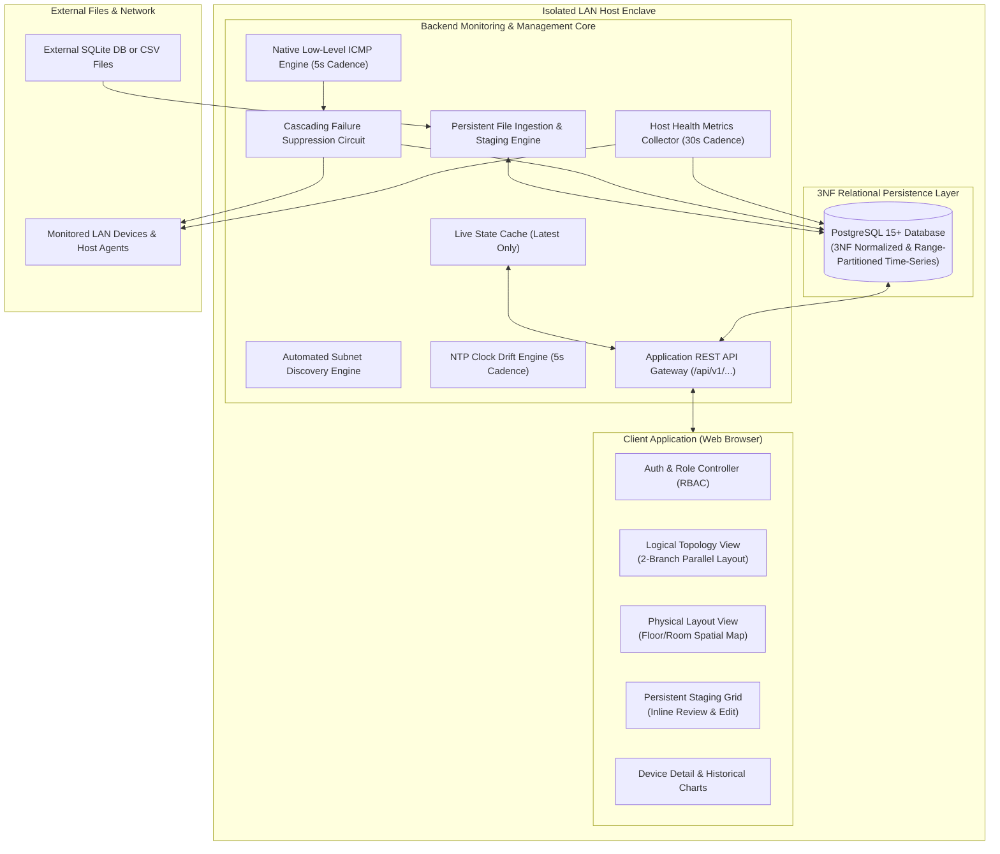

# Master Software Requirements Specification (SRS)
## System: Industrial LAN Monitoring and Management Platform (Network Observer)

**Document Version:** 2.2 (Fully Harmonized Master Specification — C# .NET 8 / Vue 3 / Cytoscape)  
**Date:** 18 October 2026  
**Status:** Approved Master Baseline  
**Standard Compliance:** IEEE 830 / ISO/IEC/IEEE 29148  
**Specification Boundary:** Aligned with `software_architecture_and_libraries_specification.md` (C# .NET 8, EF Core, PostgreSQL 18, Vue 3, Cytoscape.js, Apache ECharts).

---

## Document Control

| Property | Specification Value |
| :--- | :--- |
| **System Title** | LAN Monitoring and Management System |
| **Project Code** | Network Observer |
| **Baseline Version** | 2.1 |
| **Target Enclave** | Isolated, Air-Gapped Local Area Networks (LAN) |
| **Document Purpose** | Unified functional, non-functional, data, and interface requirements establishing the authoritative architectural contract for real-time reachability, host health telemetry, physical spatial layouts, time-series persistence, and persistent bulk ingestion. |

---

## 1. Introduction & Architectural Intent

### 1.1 Purpose
This document establishes the definitive requirements for **Network Observer**, a high-reliability, air-gapped network monitoring platform. The system operates entirely offline to provide sub-millisecond network reachability verification, host operating health metrics, automated subnet discovery, persistent multi-format file ingestion, dual-view graphical topology and spatial floorplans, and relational time-series analytics.

### 1.2 System Scope & Scope Boundaries
1. **Site-Scoped Single Enclave**: Version 2.1 is scoped to monitor **one operational Site per installation**. The database maintains a normalized `sites` table pre-seeded with a default site (`site_id = 1`), enabling future multi-site federation without schema refactoring.
2. **Device Identity & Addressing**: Devices are uniquely and immutably identified by their physical **MAC Address**. The **Primary IP Address** is tracked as a mutable operational attribute used for network polling.
3. **Cross-Subnet Hardware Identity Resolution**:
   * *Local Broadcast Domain*: Direct ARP cache resolution.
   * *Remote Routed Subnets*: Three-tier resolution strategy using SNMP switch bridge tables (`ipNetToMediaTable`), host agent telemetry payloads, or operator entry via the staging grid.
4. **Dual-Layer Telemetry Architecture**:
   * *Network Layer (High-Frequency)*: Low-level ICMP reachability, RTT latency, rolling packet loss, and microsecond clock drift (NTP) evaluated every 5 seconds.
   * *Host Layer (Medium-Frequency)*: Operating system health metrics (CPU, RAM, multi-volume disk storage, network throughput) polled from host agents every 30 seconds.
5. **Zero In-Memory History (Database Time-Series Engine)**: The runtime core retains only the latest state in volatile memory. All historical reachability and health samples are persisted directly into an indexed, 3NF normalized PostgreSQL 15+ database with declarative daily range-partitioning for zero-lock purging and microsecond queries.
6. **Strict "Never Zero for Missing Data" (N/A) Mandate**: Missing, timed-out, or unsupported telemetry metrics are strictly stored as `NULL` and presented to operators as `N/A`. They are never converted to zero (`0`).
7. **Canvas Presentation**:
   * *Logical Topology View [ACTIVE MVP]*: Hierarchical tree featuring a **2-branch parallel endpoint layout** under access switches to eliminate horizontal bloat.
   * *Physical Layout View [DEFERRED: FUTURE DEVELOPMENT]*: Spatial floorplan visualization rendered from self-contained JSON layout files without drawing logical cables (schema and data models preserved; execution deferred to Milestone 2).
8. **Industrial Persistent Staging Pipeline**: External SQLite databases and CSV files are staged in persistent database tables (`import_batches` and `staged_devices`), surviving browser crashes or reboots. Only records with `validation_status = 'VALID'` are committed.
9. **Absolute Single Source of Truth Mandate**: This specification, along with the PRD and 3NF Schema Spec, represents the absolute authoritative contract for all functionality, interfaces, and architecture. Any requested modification that is not documented must be rejected with: *"I cannot trace this back to the document / It contradicts the document"*. Documentation must be formally revised and approved first before any implementation changes proceed.
10. **Prototype Architecture Boundary**: The standalone HTML prototype (`the_observer_tactical_spa.html`) is approved solely as a structural layout and item-placement skeleton. Visual aesthetics, UI polish, micro-interactions, and visual UX are recognized as preliminary and will undergo a comprehensive redesign during production UI implementation.

---

## 2. Domain Terminology & Definitions

| Term | Formal Definition |
| :--- | :--- |
| **Site** | The overarching physical or administrative facility monitored by the installation (`site_id = 1`). |
| **Group** | The primary operational category of assets within a Site (e.g., "Engineering", "Operations"). Stored with `parent_group_id = NULL`. |
| **Subgroup** | A secondary organizational tier nested within a Group (e.g., "Workstations", "SCADA Controllers"). Stored with `parent_group_id = <parent_group_id>`. |
| **Device** | An addressable network asset uniquely identified by an immutable **MAC address** and operating on a **Primary IP**. |
| **Primary IP** | The mutable IPv4/IPv6 address used by the system to reach and monitor the device. |
| **MAC Address** | The immutable Media Access Control hardware identifier (`XX:XX:XX:XX:XX:XX`) serving as the device's business key. |
| **Core Router** | Root node of the logical network tree; has no upstream parent (`parent_device_id = NULL`). |
| **Aggregate Switch** | Middle distribution network switch; uplinks directly to a Core Router. |
| **Access Switch** | Edge switch providing connections to endpoints and servers; uplinks directly to an Aggregate Switch. |
| **Endpoint / Server** | Leaf devices connecting to an Access Switch and assigned to a Group/Subgroup. |
| **Import Batch** | A persistent database record (`import_batches`) representing an uploaded external file and its staged rows. |
| **Staged Device** | An uncommitted asset record (`staged_devices`) awaiting operator review, MAC completion, and validation. |
| **Cascading Suppression** | An operational circuit where failure of an upstream switch logically renders all downstream children unreachable, actively suppressing synthetic pings. |
| **N/A (Not Available)** | A metric value that is unsupported, unreadable, or missing; **must always be stored as `NULL` and rendered as `N/A`**. |

---

## 3. Overall Description & Operating Model

---

## 4. User Classes & Role-Based Access Control (RBAC)

The system enforces three distinct operational security roles via cryptographically signed session tokens:

| Role Code | Role Name | System Permissions & Operational Boundary |
| :--- | :--- | :--- |
| `NETWORK_ADMIN` | Network Admin | Full administrative authority. Account provisioning, role assignments, global site configuration, Core/Aggregate Switch CRUD, bulk staging commit gatekeeper, and full audit log inspection. |
| `NETWORK_ENGINEER` | Network Engineer | Operational topology and connectivity. Access Switch CRUD and switch uplinks, active subnet discovery sweeps (`/api/v1/discovery/scan`), Group and Subgroup hierarchy management, physical floorplan calibration, staging uploads/grid sanitization, and switch maintenance mode toggling. |
| `IT_SUPPORT` | IT Support | Frontline endpoint operations. Leaf device CRUD (Workstations, PCs, Servers, PLCs, Printers), updating mutable primary IPs, display names, vendor/model tags, physical zones, linking endpoints to Access Switches (`parent_device_id`), spatial floorplan placement, viewing live telemetry/host health HUD, and toggling endpoint maintenance mode. |

### 4.1 Account Provisioning & Zero Self-Registration Policy
* **Prohibited Public Sign-Up**: The system contains no self-registration or public sign-up endpoints. All user accounts must be explicitly created by an authenticated `NETWORK_ADMIN`.
* **Administrative User Management**: `NETWORK_ADMIN` operators create accounts (`POST /api/v1/users`), assign roles, reset passphrases, and toggle active/inactive states.
* **Immutable Hardware Keys Across All Roles**: Once a device is registered, its physical `mac_address` is permanently locked and cannot be edited by any role, preserving audit and historical integrity.

---

## 5. System Features & Functional Requirements

### 5.1 Device Inventory & Hardware Identity
* **FR-INV-01 (MAC Address as Unique Identity)**: Each monitored device is uniquely and immutably identified by its physical MAC Address (`XX:XX:XX:XX:XX:XX`). MAC addresses serve as unique business keys.
* **FR-INV-02 (Mutable Primary IP)**: Devices maintain a Primary IP Address used for network polling. Modifying a device's IP address shall not break its database identity, historical telemetry records, layout placement, or topological relationships.
* **FR-INV-03 (Cross-Subnet Hardware Identity Resolution)**:
  * For local subnet segments, the discovery engine resolves MAC addresses via the host ARP cache.
  * For remote routed subnets, the engine queries upstream switches via SNMP (`RFC 1213 ipNetToMediaTable` / `RFC 4293 ipNetToPhysicalTable`) or extracts the MAC address reported by the endpoint's host health agent.
  * If unresolvable, the device is staged with `validation_status = 'INCOMPLETE'` for operator entry.
* **FR-INV-04 (Adjacency Tree Topology)**: Network hierarchy is modeled via a single self-referencing `parent_device_id` foreign key. The system enforces the 4-layer physical flow:
  $$\text{Core Router} \longrightarrow \text{Aggregate Switch} \longrightarrow \text{Access Switch} \longrightarrow \text{Endpoints / Servers}$$
* **FR-INV-05 (Safe Orphan Handling)**: Disconnecting a device sets `parent_device_id = NULL`. Deleting an upstream switch converts immediate children into unparented orphan nodes, preserving their inventory and historical telemetry.

---

### 5.2 Multi-Level Categorization: Site, Groups, and Subgroups
* **FR-GRP-01 (Site Scope & Management)**: The system monitors a single physical or administrative site per deployment. Site details are manageable via `/api/v1/site`.
* **FR-GRP-02 (Unified Self-Referencing Hierarchy)**: Groups and Subgroups are stored in a single 3NF table (`groups`). Top-level Groups have `parent_group_id = NULL`; Subgroups have `parent_group_id` pointing to an existing group.
* **FR-GRP-03 (System Unassigned Group)**: The system maintains a permanent fallback group (`group_id = 1`, `group_name = 'Unassigned Group'`). Deleting a group automatically re-assigns its member devices to the Unassigned group.
* **FR-GRP-04 (Group CRUD API)**: The API provides unified endpoints (`/api/v1/groups`) supporting creation, renaming, moving, and deletion of both Groups and Subgroups via the `parent_group_id` attribute.

---

### 5.3 External Data Ingestion & Persistent Bulk Staging (SQLite / CSV) [PROVISIONAL: SUBJECT TO REVISION DURING DEVELOPMENT]

> [!NOTE]
> **Implementation Lifecycle Status: Provisional (Not Final)**  
> The external file ingestion and persistent staging workflows documented below represent an initial architectural baseline. Per project directives, these structures will be finalized during active development once real-world file fixtures and ingestion requirements are verified. All changes will be documented here first before coding.

* **FR-ING-01 (Multi-Format File Upload)**: Network Admins and Network Engineers can upload external SQLite databases (`.db`, `.sqlite`) or Comma-Separated Values (`.csv`) files.
* **FR-ING-02 (Persistent Database Staging Tables)**: Uploaded files are inserted into `import_batches` and `staged_devices`. Batches persist across server reboots, network interruptions, and browser closes.
* **FR-ING-03 (Automated Pre-Resolution Engine)**: Upon upload, the backend automatically:
  * Resolves `parent_ip` strings to existing devices' `parent_device_id`.
  * Resolves nested group paths (e.g., `"Operations / Assembly Line A"`) into hierarchical `group_id` foreign keys, creating missing groups if requested.
  * Checks MAC addresses against live inventory to detect updates versus new assets.
* **FR-ING-04 (Missing Value Tolerance & Validation Flags)**: Rows missing required fields (e.g. missing MAC address) are stored with `validation_status = 'INCOMPLETE'` with explicit error text. Conflicting MACs or duplicate IPs are flagged as `'CONFLICT'`. Fully valid rows are marked `'VALID'`.
* **FR-ING-05 (Interactive Staging Grid UI)**: The web client renders an interactive spreadsheet-like grid displaying all staged rows. Incomplete or conflicting rows are visually highlighted. Operators can edit cells inline (e.g., entering MACs) or select values from dropdowns.
* **FR-ING-06 (Atomic Bulk Commissioning Gatekeeper)**:
  * The commit endpoint (`POST /api/v1/ingest/batches/{batch_id}/commit`), authorized exclusively for **Network Admins**, commits valid records to the live `devices` table within a single atomic database transaction.
  * Incomplete rows remain staged in `staged_devices` until resolved or discarded.
  * Newly committed devices enter monitoring in the initial **`UNKNOWN`** state.
* **FR-ING-07 (Batch Discard & Audit Trail)**: Network Admins can purge staged batches (`DELETE /api/v1/ingest/batches/{batch_id}`). All batch operations are permanently recorded in `audit_logs`.

---

### 5.4 Reachability Monitoring & State Progression
* **FR-RCH-01 (Native ICMP Dispatch)**: The engine transmits RFC 792 ICMP Echo Requests cyclically every 5 seconds to all enabled devices without spawning external shell processes.
* **FR-RCH-02 (Deterministic Initial UNKNOWN State)**:
  * On initial provisioning, file import, or daemon restart, reachability status **shall be strictly `UNKNOWN`**.
  * Status transitions to `REACHABLE` upon the first verified ICMP Echo Reply.
  * Status transitions to `UNREACHABLE` if no reply is received within 2 seconds.
* **FR-RCH-03 (Strict N/A Rule for Nullable Telemetry)**:
  * When a device is `UNREACHABLE`, `latency_us` is stored as `NULL` and rendered as `N/A`.
  * For nodes without an active NTP service or timing out, `ntp_offset_us` is stored as `NULL` and rendered as `N/A`.
  * The system **shall never convert missing or timed-out metrics to zero (`0`)**.
* **FR-RCH-04 (Clock Drift Profiling)**: Responsive nodes are queried asynchronously via RFC 1305 NTP client requests (UDP port 123) to compute clock drift relative to the server in microseconds.

---

### 5.5 Cascading Failure Suppression Circuit
* **FR-CAS-01 (Switch Outage Detection)**: When an upstream Core Router, Aggregate Switch, or Access Switch fails reachability, the suppression circuit activates immediately.
* **FR-CAS-02 (Downstream Ping Suppression)**:
  * All downstream devices linked beneath the failed switch are immediately marked `UNREACHABLE` with an internal `is_suppressed = 1` flag.
  * The polling engine actively **suppresses synthetic ICMP and NTP packets** to downstream devices for the duration of the parent outage, eliminating network packet storms.
* **FR-CAS-03 (Time-Series Suppression Semantics)**:
  * Upon switch failure, the engine writes a single status sample for each child node with `status_id = 3 (SUPPRESSED)`, `is_suppressed = 1`, and `latency_us = NULL`.
  * Redundant 5-second sample writes are throttled during continuous suppression.
  * Historical chart renderers display the suppressed interval as an explicit "Upstream Outage" visual block, distinguishing it from missing telemetry gaps.
* **FR-CAS-04 (Automatic Recovery)**: When the parent switch recovers, normal polling resumes automatically for all child nodes.

---

### 5.6 Host Health Telemetry Collection
* **FR-HST-01 (Decoupled Collection Cadence)**: Host operating health is queried independently of 5-second ICMP reachability on a configurable **30-second interval** to minimize network overhead.
* **FR-HST-02 (Host Metrics Surface)**: Collects operating system metrics from workstations and servers:
  * **CPU Utilization**: Percentage (0.0% to 100.0%).
  * **RAM Utilization**: Percentage (0.0% to 100.0%).
  * **Network Throughput**: Receive (Rx) and Transmit (Tx) throughput in Kbps.
  * **Multi-Volume Disk Storage**: Partition name, utilized %, total capacity GB, and free space GB (stored in normalized `disk_volume_samples`).
  * **Hardware Temperature**: Optional reading in degrees Celsius.
* **FR-HST-03 (Collection Architecture & Protocols)**:
  * *Windows & Linux Endpoints*: Queried via a lightweight local HTTP/JSON metrics agent listening on a configurable TCP port (default `9182`).
  * *Network Switches & Routers*: Queried via standard SNMP (`HOST-RESOURCES-MIB` / `CISCO-PROCESS-MIB`). If SNMP is disabled or unsupported, health status is set to `UNSUPPORTED` (`NULL` metrics rendered as `N/A`).
* **FR-HST-04 (Independence from Reachability)**: An endpoint that responds to ping but fails host metrics collection remains `REACHABLE` with health status marked `UNAVAILABLE`.

---

### 5.7 Automated Subnet Discovery & Topology Authoring
* **FR-DSC-01 (Range Sweeps)**: Supports asynchronous scanning of IPv4 CIDR blocks using ARP sweeps, ICMP sweeps, and OS service fingerprinting.
* **FR-DSC-02 (Heuristic Device Typing)**: Inferred device types (`CORE_ROUTER`, `AGGREGATE_SWITCH`, `ACCESS_SWITCH`, `SERVER`, `PC`) are generated from MAC OUI vendor signatures, hostnames, and open ports.
* **FR-DSC-03 (Operator Authoring)**: Discovered nodes are staged for review; topological uplink connections are explicitly authored by operators or mapped via persistent spreadsheet imports.

---

### 5.8 Topology Visualization & Future Spatial Layouts
* **FR-VUE-01 (Logical Topology with 2-Branch Parallel Layout) [ACTIVE MVP / PHASE 1]**:
  * Renders a top-to-bottom hierarchy (`Core Router` $\rightarrow$ `Aggregate Switch` $\rightarrow$ `Access Switch`).
  * **2-Branch Parallel Endpoint Placement**: Endpoints under each Access Switch are programmatically arranged into two parallel vertical columns (Branch 1 left, Branch 2 right) beneath the switch. This prevents horizontal canvas blowout and eliminates intersecting cable lines:
    $$\text{Branch 1 (Left): } X_i = X_{\text{switch}} - \Delta X, \quad Y_i = Y_{\text{switch}} + (i \cdot \Delta Y)$$
    $$\text{Branch 2 (Right): } X_j = X_{\text{switch}} + \Delta X, \quad Y_j = Y_{\text{switch}} + (j \cdot \Delta Y)$$
* **FR-VUE-02 (Physical Spatial Floorplan View) [DEFERRED: FUTURE DEVELOPMENT / MILESTONE 2]**:
  * *Status*: Data model and schema established; active implementation deferred to Milestone 2.
  * Displays spatial room/floor diagrams loaded from self-contained JSON files registered in `physical_layouts`.
  * Nodes are rendered at exact $(X, Y)$ coordinates over architectural background images.
  * **Zero Logical Cables**: Physical views render device status badges at spatial positions only; no topological cable lines are drawn.

---

### 5.9 Relational Time-Series Engine (Zero In-Memory History)
* **FR-HIS-01 (Direct Database Persistence)**: All reachability samples, health samples, and disk partition metrics are written directly to the relational database. Volatile memory retains only the current state cache.
* **FR-HIS-02 (Micro-Batch Ingestion)**: High-frequency ICMP samples (200 checks/sec for 1,000 nodes) are batched in 1-second micro-transactions, preventing database write-lock contention.
* **FR-HIS-03 (Indexed Historical Queries)**: Multi-column indexes on `(device_id, recorded_at DESC)` ensure historical time-range queries across millions of rows return in under 200 ms.

---

### 5.10 Standardized Application REST API Surface
All endpoints are versioned under `/api/v1/` and enforce Role-Based Access Control:

| Method | Endpoint | Authorized Roles | Description |
| :--- | :--- | :--- | :--- |
| `POST` | `/api/v1/auth/login` | Enclave Public | Authenticate credentials; return session token and assigned role. Zero self-registration. |
| `PUT` | `/api/v1/auth/password` | All Roles | Authenticated operator updates their own passphrase (verifies current password). |
| `GET` | `/api/v1/users` | Network Admin | List all provisioned operator accounts. |
| `POST` | `/api/v1/users` | Network Admin | Provision a new operator account (Username, Role, Initial Passphrase). |
| `PUT` | `/api/v1/users/{id}` | Network Admin | Update user role, reset passphrase, or toggle active/inactive status. |
| `DELETE`| `/api/v1/users/{id}` | Network Admin | Deactivate/remove an operator account. |
| `GET` | `/api/v1/site` | All Roles | Retrieve active site configuration (`site_id = 1`). |
| `PUT` | `/api/v1/site` | Network Admin | Update site name, facility code, or description. |
| `GET` | `/api/v1/groups` | All Roles | List groups and subgroups (`?parent_id=` for nested filtering). |
| `POST` | `/api/v1/groups` | Network Admin, Network Engineer | Create a new Group or Subgroup (`parent_group_id`). |
| `PUT` | `/api/v1/groups/{id}` | Network Admin, Network Engineer | Rename or move a group/subgroup. |
| `DELETE`| `/api/v1/groups/{id}` | Network Admin, Network Engineer | Delete group; assigned devices re-assigned to Unassigned group. |
| `GET` | `/api/v1/topology` | All Roles | Fetch complete logical hierarchy and latest reachability cache. |
| `GET` | `/api/v1/devices` | All Roles | List inventory devices with operational metadata and filter params. |
| `GET` | `/api/v1/devices/{id}` | All Roles | Get single device by integer `device_id` (or `?mac=` query). |
| `POST` | `/api/v1/devices` | Admin (Backbone), Engineer (Access Sw), Support (Endpoints) | Commission a new device record. IT Support restricted to leaf endpoints. |
| `PUT` | `/api/v1/devices/{id}` | Admin (Backbone), Engineer (Switches), Support (Endpoints) | Update mutable operational attributes (Primary IP, display name, zone, parent switch). MAC is immutable for all. |
| `DELETE`| `/api/v1/devices/{id}` | Admin (Backbone), Engineer (Access Sw), Support (Endpoints) | Safely delete a device record with orphan-safe foreign key decoupling. |
| `GET` | `/api/v1/devices/{id}/history` | All Roles | Query time-series reachability and health samples over a time window. |
| `GET` | `/api/v1/monitoring/config` | All Roles | Retrieve global polling cadences, timeouts, and cascade suppression state. |
| `PUT` | `/api/v1/monitoring/config` | Network Admin, Network Engineer | Update global reachability/health polling cadences and timeouts. |
| `POST` | `/api/v1/ingest/upload` | Network Admin, Network Engineer | Upload external CSV or SQLite file into persistent staging; returns `batch_id`. |
| `GET` | `/api/v1/ingest/batches` | Network Admin, Network Engineer | List all persistent staging batches and their validation status. |
| `GET` | `/api/v1/ingest/batches/{id}` | Network Admin, Network Engineer | Retrieve staged records and validation errors for grid review. |
| `PUT` | `/api/v1/ingest/records/{id}` | Network Admin, Network Engineer | Update an individual staged record (e.g., enter missing MAC or parent IP). |
| `POST` | `/api/v1/ingest/batches/{id}/commit`| Network Admin | Atomically commit valid staged records into live `devices` table (Commit Gatekeeper). |
| `DELETE`| `/api/v1/ingest/batches/{id}` | Network Admin | Discard and purge an uncommitted staging batch. |
| `GET` | `/api/v1/layouts` | All Roles | List registered physical spatial layouts. |
| `GET` | `/api/v1/layouts/{id}` | All Roles | Fetch physical layout JSON and canvas coordinates. |
| `POST` | `/api/v1/discovery/scan` | Network Admin, Network Engineer | Trigger an asynchronous subnet discovery sweep. |
| `GET` | `/api/v1/audit/logs` | Network Admin | Retrieve immutable security and operational audit trail. |

---

## 6. Data Requirements & 3NF Schema Model

Transitive and partial dependencies are eliminated through strict 3NF normalization:
1. **Normalized Lookups**: Device types (`device_types`), reachability statuses (`reachability_status_types`), and health statuses (`health_status_types`) eliminate repeated string literals.
2. **Unified Group Hierarchy**: A single self-referencing `groups` table models both root Groups and nested Subgroups via `parent_group_id`.
3. **Multi-Volume Storage Normalization (1NF)**: Multi-partition disks are stored in a dedicated child table (`disk_volume_samples`) linked to the health sample, preventing comma-separated strings or fixed partition columns.
4. **Decoupled Spatial Placements**: The relational database stores layout metadata; $(X, Y)$ coordinate matrices remain inside JSON layout files.

---

## 7. Non-Functional Requirements (Quality Attributes)

* **NFR-01 (100% Air-Gapped Autonomy)**: Zero external internet access, CDNs, or external package registries. All UI assets, fonts, icons, and styles are served locally.
* **NFR-02 (High-Density Polling Scale)**: The engine monitors at least 1,000 devices at 5-second ICMP intervals with less than 5% average CPU load on a standard 4-core workstation.
* **NFR-03 (Rapid Historical Queries)**: Time-series sample queries across 1,000,000 samples return within 200 milliseconds.
* **NFR-04 (ACID Transactional Integrity)**: All device commissioning, group renames, and batch staging commits execute within ACID-compliant database transactions.
* **NFR-05 (Audit Logging)**: All configuration mutations, batch staging commits, and deletions are permanently recorded in `audit_logs`.
* **NFR-06 (Zero-RAM-Spike Ingestion Pipeline)**: Ingestion of bulk CSV/inventory files must not load entire payloads into unmanaged heap memory. The C# backend engine must use batched streaming via Entity Framework Core and Npgsql direct bulk operations, maintaining backend RSS memory comfortably within a 60 MB – 100 MB working ceiling.
* **NFR-07 (Client-Side Memory Bounding & Visual Virtualization)**: The Vue 3 client must maintain a flat memory footprint ($\le 100\text{ MB}$ JS heap, 60–100 MB working ceiling) using `markRaw()` on the Cytoscape.js canvas and Apache ECharts instances, `shallowRef()` for high-frequency telemetry batches, and strict viewport pagination (50 rows default).

---

## 8. Approved Implementation Tech Stack Baseline

* **Database Engine**: **PostgreSQL 16+ / 17+ / 18+** (Level 3 Normalized 3NF Relational Architecture with declarative daily range partitioning on `reachability_samples` and `health_samples`, PL/pgSQL immutability triggers on `audit_logs`).
* **Backend Architecture & Engine**: **C# (.NET 8 LTS) ASP.NET Core Web API** adhering to a **Strict 4-Tier Layered Architecture** (Presentation $\rightarrow$ Application $\rightarrow$ Domain $\rightarrow$ Infrastructure).
  * **ORM & Persistence**: **Entity Framework Core 8 (EF Core)** + `Npgsql.EntityFrameworkCore.PostgreSQL` for 100% type-safe compile-time LINQ queries with **zero raw SQL**.
  * **Telemetry Engines**: `System.Net.NetworkInformation.Ping` asynchronous batching + `IHostedService` / `BackgroundService` daemon workers.
  * **Security**: Argon2id password hashing (`Isopoh.Cryptography.Argon2`), CSPRNG 256-bit session tokens.
* **Frontend Architecture & Visuals**: **Vue 3 + Vite + TypeScript + Tailwind CSS** (Pinia state management, Cyber-Tactical dark theme).
  * **Topology Visualization**: **Cytoscape.js** (`cytoscape` + `cytoscape-dagre`) multi-layer HTML5 Canvas engine with declarative CSS-like cyber stylesheets, `cy.batch()` polling updates, and graph traversal algorithms (`.successors()`) for downstream cascading alert suppression.
  * **Telemetry & HUD Charts**: **Apache ECharts** (`echarts` + `vue-echarts`) for real-time latency sparklines, gauges, and historical telemetry charts.
* **Unified Fullstack Monolith**: Single ASP.NET Core Kestrel host serving both `/api/v1/...` REST endpoints and compiled production Vue 3 `/dist` assets from port `8443` (or configurable), with zero external runtime dependencies.
