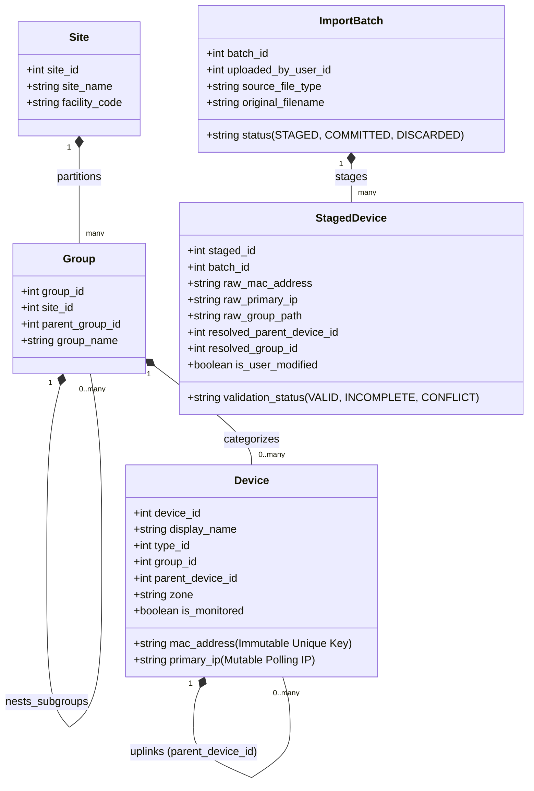
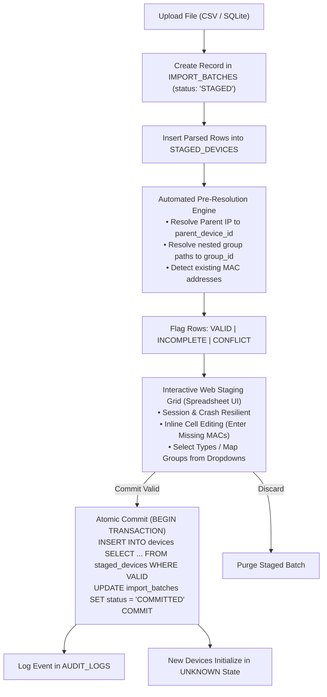

# Project Requirements Document (PRD)
## System: Network Observer — Industrial LAN Telemetry & Topology Management Platform

---

### Document Control & Terminology Alignment

| Property | Value |
| :--- | :--- |
| **System Name** | Network Observer |
| **Document Version** | 2.2 (Fully Harmonized Master Specification — C# .NET 8 / Vue 3 / Cytoscape) |
| **Status** | Approved Master Baseline |
| **Classification** | Internal / Engineering & Client Reference |
| **Target Runtime** | Isolated, Air-Gapped Local Area Networks (LAN) |
| **Specification Boundary** | Aligned with `software_architecture_and_libraries_specification.md` (C# .NET 8, EF Core, PostgreSQL 18, Vue 3, Cytoscape.js, ECharts). |

> [!IMPORTANT]
> **Domain Architecture Directives**  
> 1. **Site Scope**: Scoped to monitor a **single physical or administrative Site per installation**. The database seeds a default site (`site_id = 1`), manageable via `/api/v1/site`.
> 2. **Groups & Subgroups**: Unified in a single self-referencing 3NF table (`parent_group_id`). Top-level categories are Groups; nested tiers are Subgroups. The legacy term "Tiers" is deprecated.
> 3. **Hardware Identity**: Devices are immutably identified by **MAC Address**. The **Primary IP** is a mutable operational polling address.
> 4. **Strict N/A Representation**: Unsupported, timed-out, or missing metrics are stored as `NULL` and rendered as `N/A`. They are **never converted to zero (`0`)**.
> 5. **Persistent Database Staging**: File imports (`.csv`, `.db`) are persisted in database staging tables (`import_batches`, `staged_devices`), surviving browser closures and crashes. Only rows with `validation_status = 'VALID'` are committed to production.
> 6. **Documentation as Absolute Single Source of Truth**: These specification documents represent the sole, immutable authority. Any requested modification or feature not documented herein must be halted with: *"I cannot trace this back to the document / It contradicts the document"*. Specifications must be formally updated and approved before any implementation changes proceed.
> 7. **Prototype Role & Fidelity Boundary**: The interactive HTML prototype (`the_observer_tactical_spa.html`) is approved solely as a structural layout skeleton and item-placement reference. Its visual styling and UX will undergo comprehensive redesign and overhaul during production frontend engineering.

---

## 1. Executive Summary & Problem Statement

### 1.1 Business Context
Mission-critical industrial enclaves (SCADA networks, power plants, manufacturing plants, defense facilities, air-gapped data centers) operate under strict isolation guidelines. External cloud services, public CDNs, package managers, and telemetry phone-home daemons are strictly prohibited. 

In these environments, network operators require a self-contained, 100% offline platform to:
1. Continuously monitor network reachability, latency, packet loss, and microsecond clock drift across all devices.
2. Collect host operating health (CPU, RAM, multi-volume disk storage, and network throughput) on monitored workstations and servers without conflating host health with network reachability.
3. Model and visualize the dual nature of infrastructure: **Logical 4-layer network topology** (with access-switch 2-branch parallel endpoint layout) and **Physical spatial layouts** (canvas floorplans loaded from self-contained JSON layout files).
4. Ingest bulk inventory from external spreadsheets (CSV) and database files through an **industrial-grade persistent staging pipeline** that tolerates missing attributes (like MAC addresses or switch parents), allows multi-session manual editing, and guarantees atomic commit.
5. Prevent cascading alarm storms during switch outages by automatically suppressing downstream pings.
6. Provide an enterprise-grade time-series historical query engine backed entirely by a normalized 3NF PostgreSQL 15+ database with declarative time-series range partitioning and zero volatile in-memory history.

---

## 2. User Personas & Role-Based Access Control (RBAC)

The platform enforces three strict operational security roles tailored to air-gapped industrial local area network environments:

| Role Name | Access Level / Code | Responsibilities & Permissions |
| :--- | :--- | :--- |
| **Network Admin** | Full Administrative Authority (`NETWORK_ADMIN`) | Full system governance. User account provisioning and role assignment, global site configuration, Core/Aggregate Switch CRUD, bulk file staging commitment gatekeeper, and full audit log inspection. |
| **Network Engineer** | Topology & Connectivity Authority (`NETWORK_ENGINEER`) | Operational network topology management. Access Switch CRUD and switch uplinks, active subnet discovery sweeps (`/api/v1/discovery/scan`), Group and Subgroup hierarchy structuring, physical floorplan blueprint upload/calibration, staging bulk file uploads and grid sanitization, and switch maintenance mode toggling. |
| **IT Support** | Frontline Endpoint Operations (`IT_SUPPORT`) | Field asset maintenance and workstation/server onboarding. Leaf device CRUD (PCs, Workstations, Servers, PLCs, Printers), updating mutable operational primary IPs, display names, vendor/model tags, physical zones, linking endpoints to Access Switches (`parent_device_id`), spatial floorplan placement, viewing live telemetry/host health metrics, and toggling endpoint maintenance mode. |

### 2.1 Zero Self-Registration & Account Provisioning Policy
* **Strictly Prohibited Self-Registration**: In accordance with air-gapped industrial defense standards, the system provides **zero public sign-up or self-registration** interfaces.
* **Administrative Account Provisioning**: Only authenticated **Network Admins** have the authority to create user accounts, set initial credentials, assign roles, reset passphrases, and deactivate accounts (`POST /api/v1/users`).
* **Immutable Hardware Keys Across All Roles**: The MAC address (`mac_address`) remains an immutable natural hardware identifier; neither Network Admins, Network Engineers, nor IT Support can edit a device's MAC address once created.

---

## 3. Domain Model & Hierarchy Rules

### 3.1 Structural 4-Layer Hierarchy Constraints
Topological connectivity enforces the physical flow of network packets:
1. **Core Router**: Root gateway of the site. `parent_device_id` must be `NULL`.
2. **Aggregate Switch**: Distribution layer. Must uplink directly to a **Core Router**.
3. **Access Switch**: Edge distribution switch. Must uplink directly to an **Aggregate Switch**.
4. **Endpoints & Servers**: Leaf devices. Must uplink directly to an **Access Switch** and belong to a **Group** or **Subgroup**.
5. **No Child Device ID Column**: Devices record uplinks solely via `parent_device_id`. Access switches have multiple child endpoints naturally queryable via foreign key adjacency.

### 3.2 MAC-Centric Hardware Identity & Cross-Subnet Resolution
* **Immutable Hardware Key**: A device is uniquely identified across its operational lifetime by its physical **MAC Address** (`XX:XX:XX:XX:XX:XX`).
* **Mutable Primary IP**: Polling IP is a mutable operational attribute. Changing a device's IP address does **not** break its identity, its historical telemetry records, its group membership, or its topological parentage.
* **Cross-Subnet Hardware Identity Resolution Strategy**:
  1. *Local Broadcast Domain*: Directly query local ARP cache.
  2. *Remote Routed Subnets*: Query upstream switches via SNMP bridge tables (`RFC 1213 ipNetToMediaTable` / `RFC 4293 ipNetToPhysicalTable`) to resolve remote IP-to-MAC mappings, or extract MAC from host agent payload.
  3. *Manual Staging Entry*: Operator inputs the MAC via the interactive Staging Grid.

---

## 4. Functional Requirements (FRs)

### FR-1: Network Reachability & Precision Clock Drift Telemetry
* **FR-1.1 Native Low-Level Polling Engine**:
  * Emits RFC 792 ICMP Echo Requests cyclically every 5 seconds across all monitored devices without spawning external shell processes.
  * Encodes sequence numbers and unique process identifiers to demultiplex concurrent asynchronous responses.
* **FR-1.2 Deterministic State Progression (`UNKNOWN` Baseline)**:
  * Upon initial provisioning, bulk ingestion, or system restart, all devices initialize to the reachability status **`UNKNOWN`**.
  * The status transitions to **`REACHABLE`** upon the first verified ICMP echo reply.
  * The status transitions to **`UNREACHABLE`** if no reply is received within the 2-second timeout window.
* **FR-1.3 Round-Trip Latency & Rolling Loss**:
  * Records Round-Trip Time (RTT) in microseconds. Stored as `NULL` when unreachable.
  * Tracks cumulative sent and dropped packet counters, computing rolling packet loss percentage.
* **FR-1.4 Microsecond NTP Clock Drift Profiling**:
  * For responsive nodes, asynchronous two-way NTP client packets (RFC 1305, UDP port 123) measure clock offset relative to the server in microseconds.
  * Devices without an NTP service remain marked `REACHABLE` with clock drift recorded as `NULL` (rendered as `N/A`).
* **FR-1.5 Strict N/A Rule (Never Zero)**:
  * Unsupported, timed-out, or missing telemetry is strictly stored as `NULL` in the database and rendered in UI/API as `N/A`. The system never converts missing data to 0.

---

### FR-2: Host Operating Health Telemetry
* **FR-2.1 Decoupled Collection Cadence (30 Seconds)**:
  * Host operating health is queried independently of 5-second ICMP reachability on a configurable **30-second interval** to eliminate network packet saturation.
* **FR-2.2 Host Metrics Surface**:
  * **CPU Utilization**: Percentage (0.0% to 100.0%).
  * **RAM Utilization**: Percentage (0.0% to 100.0%).
  * **Network Throughput**: Receive (Rx) and Transmit (Tx) in Kilobits per second (Kbps).
  * **Storage Utilization**: Multi-volume disk metrics (Drive name/mount point, used %, total capacity GB, free space GB) stored in normalized `disk_volume_samples`.
  * **Hardware Temperature**: Optional thermal reading in degrees Celsius.
* **FR-2.3 Collection Architecture & Protocols**:
  * *Windows & Linux Endpoints*: Queried via a lightweight local HTTP/JSON metrics agent listening on a configurable TCP port (default `9182`).
  * *Network Switches & Routers*: Queried via standard SNMP (`HOST-RESOURCES-MIB` / `CISCO-PROCESS-MIB`). If SNMP is disabled or unsupported, health status is set to `UNSUPPORTED` (`NULL` metrics rendered as `N/A`).
* **FR-2.4 Strict Decoupling from Reachability**:
  * If an endpoint responds to ping but fails host metrics collection, its reachability remains `REACHABLE` while its health status registers as `UNAVAILABLE`.

---

### FR-3: Cascading Failure Suppression Circuit
* **FR-3.1 Root Cause Switch Outage Detection**:
  * When a Core Router, Aggregate Switch, or Access Switch fails reachability, the system initiates recursive downstream suppression.
* **FR-3.2 Downstream Ping Suppression**:
  * All downstream devices logically parented under the failed switch are immediately marked `UNREACHABLE` with `is_suppressed = 1`.
  * The polling engine actively **suppresses synthetic ICMP and NTP packets** to downstream devices for the duration of the parent switch's outage, eliminating synthetic network packet floods.
* **FR-3.3 Time-Series Suppression Semantics**:
  * Upon switch failure, the engine writes a single status sample for each child node with `status_id = 3 (SUPPRESSED)`, `is_suppressed = 1`, and `latency_us = NULL`.
  * Redundant 5-second sample writes are throttled during continuous suppression.
  * Historical chart renderers display the suppressed interval as an explicit "Upstream Outage" visual block, distinguishing it from missing telemetry gaps.
* **FR-3.4 Automatic Resumption**:
  * Upon restoration of the parent switch, polling automatically resumes for all downstream child nodes.

---

### FR-4: Multi-Level Grouping (Sites, Groups, and Subgroups)
* **FR-4.1 Single-Site Operational Boundary**:
  * Manages one dedicated operational Site per deployment (`site_id = 1`), configurable via `/api/v1/site`.
* **FR-4.2 Unified Self-Referencing Groups & Subgroups Hierarchy**:
  * Groups and Subgroups are stored within a unified 3NF table (`groups`) via `parent_group_id`.
  * Supports arbitrary nesting depth without schema changes.
* **FR-4.3 System Unassigned Group**:
  * The system reserves `group_id = 1` for the permanent `Unassigned Group`. Deleting a group automatically re-assigns its member devices to the Unassigned group.
* **FR-4.4 Unified Group CRUD API**:
  * Endpoints under `/api/v1/groups` manage both Groups and Subgroups via the `parent_group_id` parameter.

---

### FR-5: Automated Subnet Discovery & Topology Authoring
* **FR-5.1 Non-Destructive Subnet Scanning**:
  * Operators can scan defined IPv4 ranges using ARP sweeps, ICMP sweeps, and OS service fingerprinting.
* **FR-5.2 Best-Guess Heuristic Classification**:
  * Evaluates hostname patterns, MAC OUI vendor strings, and open ports to suggest device types (`CORE_ROUTER`, `AGGREGATE_SWITCH`, `ACCESS_SWITCH`, `SERVER`, `PC`).
* **FR-5.3 Manual Operator Topology Authoring**:
  * Automated discovery does not guess topological cables. Operators establish verified parent-child links via interactive linking or staged spreadsheet ingestion.

---

### FR-6: Industrial Persistent Data Ingestion & Staging Pipeline [PROVISIONAL: SUBJECT TO REVISION DURING DEVELOPMENT]

> [!NOTE]
> **Implementation Lifecycle Status: Provisional (Not Final)**  
> The ingestion pipeline architecture, staging schemas, and resolution workflows documented below serve as an initial architectural baseline. Per project directives, these structures are marked as **provisional** and will be finalized during active development once live fixtures and specific scenario requirements are available. All modifications will be documented here first before coding.

* **FR-ING-01 (Multi-Format Ingestion)**:
  * Supports uploading and parsing external **SQLite database files (`.db`, `.sqlite`)** and **Comma-Separated Values (`.csv`)** containing columns such as `ip`, `name`, `type`, `parent_ip`, `zone`, `site`, `group`.
* **FR-ING-02 (Persistent Database Staging Tables)**:
  * Uploaded files are immediately persisted in dedicated relational staging tables:
    * `import_batches`: Tracks batch ID, user ID, original filename, total rows, status (`STAGED`, `COMMITTED`, `DISCARDED`), and creation timestamp.
    * `staged_devices`: Stores raw row attributes (`raw_mac_address`, `raw_primary_ip`, `raw_display_name`, `raw_device_type`, `raw_group_path`, `raw_parent_identifier`, `raw_zone`, `raw_vendor`, `raw_model`, `is_monitored`), original spreadsheet row numbers, pre-resolved foreign keys, validation status flags, and user modification flags.
* **FR-ING-03 (Session & Crash Resilience)**:
  * Uncommitted staging batches persist indefinitely in the database. 
  * If the operator's browser crashes, session expires, or laptop disconnects, all staged records, uploaded rows, and partial edits remain safely stored in the database.
* **FR-ING-04 (Automated Pre-Resolution Engine)**:
  * Resolves `parent_ip` string to an existing device's internal `parent_device_id`.
  * Resolves nested group paths (e.g. `"Operations / Assembly Line A"`) to hierarchical `group_id` foreign keys.
  * Detects existing MAC addresses to distinguish between new additions and updates.
* **FR-ING-05 (Missing Value Tolerance & Error Flagging)**:
  * Missing MAC addresses, invalid IP syntax, non-existent parent switches, or unrecognized device types are non-fatal. Rows are stored with `validation_status = 'INCOMPLETE'` or `'CONFLICT'` with specific field-level error messages.
* **FR-ING-06 (Interactive Ingestion Grid UI)**:
  * High-density spreadsheet grid displaying all rows for the active batch.
  * Highlights missing values (red badges for missing MACs, amber badges for unresolved parents).
  * Enables inline cell editing: operators can manually enter MAC addresses or click "Query ARP/LAN" to auto-discover hardware MACs for responsive IPs.
  * Enables dropdown mapping for Groups, Subgroups, and Device Types.
* **FR-ING-07 (Atomic Bulk Commissioning Gatekeeper)**:
  * The commit endpoint (`POST /api/v1/ingest/batches/{id}/commit`), authorized exclusively for **Network Admins**, commits valid records (`validation_status = 'VALID'`) into the live `devices` table within a single atomic database transaction.
  * Incomplete rows remain staged until resolved or discarded.
  * Newly added devices begin polling in the `UNKNOWN` state.
* **FR-ING-08 (Batch Discard & Audit Logging)**:
  * Network Admins can discard a staged batch (`DELETE /api/v1/ingest/batches/{id}`).
  * All batch creations, edits, commits, and discards are permanently recorded in `audit_logs`.

---

### FR-7: Topology Visualization & Future Spatial Layouts
* **FR-7.1 Logical Topology View (2-Branch Parallel Endpoint Placement) [ACTIVE MVP / PHASE 1]**:
  * Renders a hierarchical graph of the network infrastructure: `Core Router` $\rightarrow$ `Aggregate Switch` $\rightarrow$ `Access Switch`.
  * **2-Branch Parallel Placement Algorithm**: Endpoints under each Access Switch are programmatically placed in two parallel vertical columns beneath the switch (Left branch and Right branch) to prevent horizontal canvas spread and eliminate intersecting lines:
    $$\text{Branch 1 (Left): } X_i = X_{\text{switch}} - \Delta X, \quad Y_i = Y_{\text{switch}} + (i \cdot \Delta Y)$$
    $$\text{Branch 2 (Right): } X_j = X_{\text{switch}} + \Delta X, \quad Y_j = Y_{\text{switch}} + (j \cdot \Delta Y)$$
  * Color-coded status glow rings (Green = `REACHABLE`, Red = `UNREACHABLE`, Amber = `UNKNOWN`).
* **FR-7.2 Physical Spatial Layout View [DEFERRED: FUTURE DEVELOPMENT / MILESTONE 2]**:
  * *Status*: Architecturally modeled and schema-ready, but deferred to a future development release. The Phase 1 MVP focuses 100% on the high-performance Logical Topology Tree.
  * Displays spatial floorplans, rack layouts, or plant rooms loaded from **self-contained layout JSON files** registered in `physical_layouts`.
  * Renders device nodes placed at exact $(X, Y)$ canvas coordinates over structural floorplan images.
  * **Zero Logical Cables**: Physical layouts display spatial device locations only; no network cables or topology lines are drawn on floorplans.
  * Decoupled from database schema: Spatial coordinates remain entirely within the layout JSON files.

---

### FR-8: Database Time-Series Persistence (Zero In-Memory History)
* **FR-8.1 Strictly Normalized 3NF Architecture**:
  * Eliminates redundant text storage via normalized lookup tables (`device_types`, `reachability_status_types`, `health_status_types`).
* **FR-8.2 Database as Time-Series Engine**:
  * **Zero in-memory history**: The application core retains only the latest state in volatile memory.
  * All historical telemetry samples (`reachability_samples`, `health_samples`, `disk_volume_samples`) are written directly to the relational database.
  * High-frequency ICMP samples (200 checks/sec for 1,000 nodes) are batched in 1-second micro-transactions, preventing database write-lock contention.
  * Historical graphs, SLA reports, and trend analytics are served via indexed time-range queries (`device_id`, `recorded_at DESC`).
* **FR-8.3 Multi-Volume Disk Normalization (1NF Compliant)**:
  * Stores individual disk partitions (e.g., `C:`, `D:`, `/var`) in a separate normalized child table (`disk_volume_samples`) linked to the health sample.

---

### FR-9: Standardized Application API Gateway
The system exposes a technology-agnostic RESTful API versioned under `/api/v1/` and secured by role-based authorization tokens:

| Method | Endpoint | Authorized Roles | Description |
| :--- | :--- | :--- | :--- |
| `POST` | `/api/v1/auth/login` | Enclave Public | Authenticate credentials; return session token and assigned role. Zero self-registration. |
| `PUT` | `/api/v1/auth/password` | All Roles | Authenticated operator updates their own passphrase (verifies current password). |
| `GET` | `/api/v1/users` | Network Admin | List all provisioned operator accounts. |
| `POST` | `/api/v1/users` | Network Admin | Provision a new operator account (Username, Role, Initial Passphrase). |
| `PUT` | `/api/v1/users/{id}` | Network Admin | Update user role, reset passphrase, or toggle active/inactive status. |
| `DELETE`| `/api/v1/users/{id}` | Network Admin | Deactivate/remove an operator account. |
| `GET` | `/api/v1/site` | All Roles | Retrieve active site configuration (`site_id = 1`). |
| `PUT` | `/api/v1/site` | Network Admin | Update site name, facility code, or description. |
| `GET` | `/api/v1/groups` | All Roles | List groups and subgroups (`?parent_id=` for nested filtering). |
| `POST` | `/api/v1/groups` | Network Admin, Network Engineer | Create a new Group or Subgroup (`parent_group_id`). |
| `PUT` | `/api/v1/groups/{id}` | Network Admin, Network Engineer | Rename or move a group/subgroup. |
| `DELETE`| `/api/v1/groups/{id}` | Network Admin, Network Engineer | Delete group; assigned devices re-assigned to Unassigned group. |
| `GET` | `/api/v1/topology` | All Roles | Fetch complete logical hierarchy and latest reachability cache. |
| `GET` | `/api/v1/devices` | All Roles | List inventory devices with operational metadata and filter params. |
| `GET` | `/api/v1/devices/{id}` | All Roles | Get single device by integer `device_id` (or `?mac=` query). |
| `POST` | `/api/v1/devices` | Admin (Backbone), Engineer (Access Sw), Support (Endpoints) | Commission a new device record. IT Support restricted to leaf endpoints. |
| `PUT` | `/api/v1/devices/{id}` | Admin (Backbone), Engineer (Switches), Support (Endpoints) | Update mutable operational attributes (Primary IP, display name, zone, parent switch). MAC is immutable for all. |
| `DELETE`| `/api/v1/devices/{id}` | Admin (Backbone), Engineer (Access Sw), Support (Endpoints) | Safely delete a device record with orphan-safe foreign key decoupling. |
| `GET` | `/api/v1/devices/{id}/history` | All Roles | Query time-series reachability and health samples over a time window. |
| `GET` | `/api/v1/monitoring/config` | All Roles | Retrieve global polling cadences, timeouts, and cascade suppression state. |
| `PUT` | `/api/v1/monitoring/config` | Network Admin, Network Engineer | Update global reachability/health polling cadences and timeouts. |
| `POST` | `/api/v1/ingest/upload` | Network Admin, Network Engineer | Upload external CSV or SQLite file into persistent staging; returns `batch_id`. |
| `GET` | `/api/v1/ingest/batches` | Network Admin, Network Engineer | List all persistent staging batches and their validation status. |
| `GET` | `/api/v1/ingest/batches/{id}` | Network Admin, Network Engineer | Retrieve staged records and validation errors for grid review. |
| `PUT` | `/api/v1/ingest/records/{id}` | Network Admin, Network Engineer | Update an individual staged record (e.g., enter missing MAC or parent IP). |
| `POST` | `/api/v1/ingest/batches/{id}/commit`| Network Admin | Atomically commit valid staged records into live `devices` table (Commit Gatekeeper). |
| `DELETE`| `/api/v1/ingest/batches/{id}` | Network Admin | Discard and purge an uncommitted staging batch. |
| `GET` | `/api/v1/layouts` | All Roles | [Future Development] List registered physical spatial layouts. |
| `GET` | `/api/v1/layouts/{id}` | All Roles | [Future Development] Fetch physical layout JSON and canvas coordinates. |
| `POST` | `/api/v1/discovery/scan` | Network Admin, Network Engineer | Trigger an asynchronous subnet discovery sweep. |
| `GET` | `/api/v1/audit/logs` | Network Admin | Retrieve immutable security and operational audit trail. |

---

## 5. Non-Functional Requirements (NFRs)

### NFR-1: Air-Gap Readiness & Zero External Dependencies
* **NFR-1.1 Complete Offline Autonomy**: The system must run, render, and persist data without any active internet connection or external gateway access.
* **NFR-1.2 Zero External Asset Requests**: All styles, icons, fonts, client code, and documentation must be bundled locally. Zero external CDN calls or outbound requests.
* **NFR-1.3 Single-Host Self-Contained Deployment**: The fullstack application runs on a dedicated host machine, communicating directly with local PostgreSQL 15+ over localhost, with zero external cloud dependencies.

### NFR-2: Performance & Real-Time Responsiveness
* **NFR-2.1 Scalable Network Polling**: The polling engine must monitor at least 1,000 devices at 5-second intervals with less than 5% average CPU load on a standard 4-core workstation.
* **NFR-2.2 Sub-Second Dashboard Updates**: Polling the live status endpoint (`GET /api/v1/topology`) must respond in under 50 milliseconds for 1,000 active nodes.
* **NFR-2.3 Fast Time-Series Queries**: Indexed historical queries across 1,000,000 samples must return within 200 milliseconds.
* **NFR-2.4 Zero-RAM-Spike Streaming Pipeline**: Ingestion of bulk CSV/inventory files must not load entire payloads into unmanaged RAM. The backend C# engine utilizes batch streaming via EF Core and Npgsql direct bulk operations, maintaining backend RSS memory comfortably within a 60 MB – 100 MB working ceiling.
* **NFR-2.5 Frontend Memory Bounding & Visual Virtualization**: The Vue 3 client maintains a flat memory footprint ($\le 100\text{ MB}$ JS heap, 60–100 MB working ceiling) using `markRaw()` on the Cytoscape.js canvas and Apache ECharts instances, `shallowRef()` for high-frequency telemetry batches, and strict viewport pagination (50 rows default).

### NFR-3: Industrial Reliability & Transactional Integrity
* **NFR-3.1 ACID Compliance**: All database mutations (device provisioning, group renames, batch commits) must be wrapped in atomic database transactions.
* **NFR-3.2 Staging Session Resilience**: Data uploaded to `import_batches` and `staged_devices` must survive system reboots, daemon restarts, and browser disconnections.
* **NFR-3.3 Safe Orphan Decoupling**: Deleting a parent switch must safely orphan child devices (`parent_device_id = NULL`) rather than triggering unintended cascading deletions.

### NFR-4: Security & Auditability
* **NFR-4.1 Role-Based Access Enforcement**: Every API endpoint must enforce role permissions. Mutation operations attempted by Read-Only Viewers must return HTTP 403 Forbidden.
* **NFR-4.2 Parameterized Query Enforcement**: 100% of database interactions must use parameterized prepared statements to eliminate SQL injection vulnerabilities.
* **NFR-4.3 Comprehensive Audit Trail**: All device creations, IP modifications, link changes, and batch import commits must be permanently recorded in `audit_logs` with timestamps and user IDs.

---

## 6. Requirement Traceability Matrix

| Requirement ID | Module / Feature | Specification Source | Verification Criteria |
| :--- | :--- | :--- | :--- |
| **FR-1.1 - FR-1.5** | Network Telemetry Engine | Master SRS § 5.4 | Verify raw ICMP/NTP polling, microsecond drift, initial `UNKNOWN` state, and strict `NULL` for missing latency/ntp. |
| **FR-2.1 - FR-2.4** | Host Health Collector | Master SRS § 5.6 | Verify 30s cadence, CPU, RAM, Disk, Net I/O; verify missing metrics stored as `NULL` and rendered as `N/A`. |
| **FR-3.1 - FR-3.4** | Cascading Failure Suppression | Master SRS § 5.5 | Disconnect access switch; verify downstream child pings are actively suppressed and marked unreachable. |
| **FR-4.1 - FR-4.4** | Sites, Groups & Subgroups | Master SRS § 5.2 | Verify single-site boundary and self-referencing hierarchy table supporting nested subgroups. |
| **FR-5.1 - FR-5.3** | Subnet Discovery & Classification | Master SRS § 5.7 | Execute scan across `/24` subnet; verify heuristic device typing and manual link authoring. |
| **FR-6.1 - FR-6.8** | Persistent Ingestion Pipeline | Master SRS § 5.3 & Schema Spec § 4, 7 | Upload CSV/SQLite; verify persistent `import_batches` / `staged_devices`, inline cell editing, and atomic commit. |
| **FR-7.1 - FR-7.2** | Dual-View Visualization | Master SRS § 5.8 | Verify 2-branch parallel endpoint layout under switches, and verify floorplan JSON rendering with zero cable lines. |
| **FR-8.1 - FR-8.3** | 3NF Schema & Time-Series History | Schema Spec § 4 | Verify zero in-memory history, normalized multi-volume disk storage, and indexed historical queries. |
| **FR-9.1** | Standardized API Gateway | Master SRS § 5.10 | Verify authentication, RBAC authorization boundaries, and parameter validation across all `/api/v1/` endpoints. |
