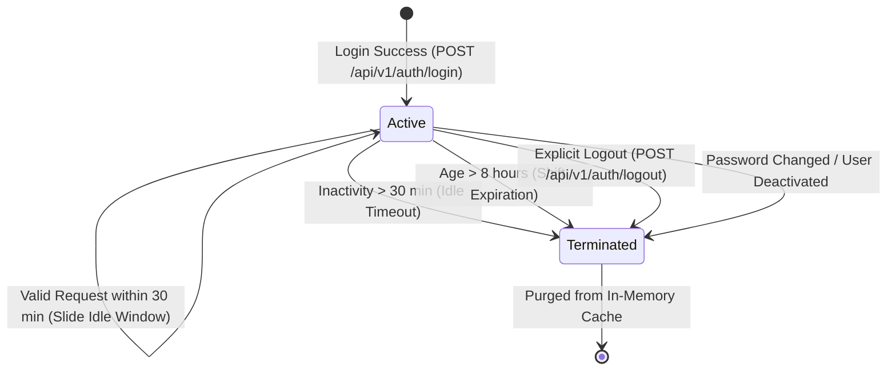

# Network Observer — Security Architecture, RBAC & Enclave Hardening Specification
**Document Version:** 2.1  
**Classification:** Restricted — Air-Gapped Industrial Enclave (SCADA / NOC Deployment)  
**Authoritative Status:** Mandatory Engineering Specification & Single Source of Truth  
**Target Workspace:** `d:\FullStackProjects\Network monitor`  
**Referenced Specifications:**
* Master SRS: [`master_software_requirements_specification.md`](file:///d:/FullStackProjects/Network%20monitor/master_software_requirements_specification.md)
* Database DDL & Ingestion: [`database_schema_and_ingestion_specification.md`](file:///d:/FullStackProjects/Network%20monitor/database_schema_and_ingestion_specification.md)
* REST API Contracts: [`api_contracts_specification.md`](file:///d:/FullStackProjects/Network%20monitor/api_contracts_specification.md)
* Cyber-Tactical UI/UX Guidelines: [`ui_guidelines_and_design_system.md`](file:///d:/FullStackProjects/Network%20monitor/ui_guidelines_and_design_system.md)
* Project Requirements: [`project_requirements_document.md`](file:///d:/FullStackProjects/Network%20monitor/project_requirements_document.md)

---

## 1. Governance Directives & Architectural Baseline

1. **Absolute Single Source of Truth**:
   This document defines the cryptographic parameters, access control matrices, authentication lifecycles, and air-gapped defensive measures for **Network Observer**. Any security control or authentication logic implemented in backend or frontend code MUST trace strictly back to this document.
2. **Document First, Code Second**:
   Security policies, session lifetimes, password complexities, or role permissions must be updated and approved within this document *before* modifying code or schemas.
3. **Strict Air-Gapped Operation**:
   Network Observer operates strictly in an isolated, air-gapped industrial LAN environment with zero outbound or inbound Internet access. There are zero external dependencies: no public CDNs, no external OAuth/OIDC providers, no remote package registries at runtime, and no telemetry phone-home capabilities.
4. **Zero Self-Registration Mandate**:
   Public user registration, open sign-ups, and unauthenticated account creation are strictly prohibited. All operator accounts are provisioned exclusively by authenticated operators holding the `NETWORK_ADMIN` role.

---

## 2. Industrial Enclave Threat Model

### 2.1 Operational Environment
The platform is deployed inside high-security operational technology (OT) and critical local area network (LAN) environments (e.g., manufacturing assembly plants, power distribution stations, SCADA control networks, tactical operations centers).

```mermaid
flowchart TB
    subgraph AirGappedEnclave["Air-Gapped Industrial Enclave (Zero Internet Access)"]
        subgraph Perimeter["Enclave Boundary"]
            direction TB
            AdminClient["Workstation: Network Admin"]
            EngClient["Workstation: Network Engineer"]
            SupportClient["Workstation: IT Support Field Tech"]
        end

        subgraph CorePlatform["Network Observer Central Host"]
            direction TB
            WebListener["TLS Web Server & REST API Gateway (:8443 / :443)"]
            AuthEngine["Auth & Session Engine (Argon2id + CSPRNG)"]
            RBACGuard["RBAC Route Guard & Policy Enforcement"]
            PollerDaemon["Native Socket Poller (ICMP / NTP / SNMP)"]
            DatabaseEngine[("PostgreSQL 15+ Engine (3NF + Range Partitioning)")]
        end

        subgraph MonitoredNetwork["Monitored LAN Infrastructure"]
            direction TB
            CoreSwitches["Core / Distribution Switches"]
            AccessSwitches["Industrial Access Switches"]
            FieldAssets["PLCs, HMIs, Workstations, Servers"]
        end
    end

    Perimeter -->|"HTTPS / Secure Cookies"| WebListener
    WebListener --> AuthEngine
    AuthEngine --> RBACGuard
    RBACGuard --> DatabaseEngine
    PollerDaemon -->|"Raw ICMP Echo / UDP NTP (No Shell Spawning)"| MonitoredNetwork
    DatabaseEngine --- PollerDaemon
```



### 2.2 Primary Threat Vectors & Mitigations

| Threat Vector | Potential Impact | Architectural Mitigation |
| :--- | :--- | :--- |
| **Unauthorized Local Operator Privilege Escalation** | Field technicians modify core backbone switches or view security logs. | Strict Three-Tier Role-Based Access Control (RBAC) enforced at the API gateway layer before database access. |
| **Credential Compromise & Offline Cracking** | Attacker extracts database backup and attempts GPU/ASIC hash cracking. | Argon2id password hashing ($m=64\text{ MB}$, $t=3$, $p=4$, $16$-byte CSPRNG salt). Immune to GPU/ASIC parallelism. |
| **Session Hijacking & Token Replay** | Rogue packet capture or browser memory scrapers reuse operator sessions. | High-entropy (256-bit) CSPRNG session tokens transported via HTTP-only, Secure, SameSite=Strict cookies; absolute 8h shift timeouts; immediate revocation blacklist. |
| **Command / Shell Injection via Diagnostics** | Attacker injects shell metacharacters (`;`, `\|`, `&`) into IP/subnet fields to run OS commands. | **Zero Shell Process Spawning**: ICMP echo pings, ARP lookups, and NTP offset queries are executed exclusively via native OS raw sockets and protocol libraries. No `exec()`, `system()`, `popen()`, `cmd.exe`, or `sh` is ever executed. |
| **SQL Injection (SQLi)** | Malformed input tampers with relational queries or extracts credentials. | 100% Parameterized Prepared Statements across all queries. Raw string interpolation in SQL is strictly prohibited and enforced via linter rules. |
| **Subnet Sweep Industrial PLC DoS** | High-rate subnet scanning overwhelms sensitive legacy PLC/RTU network stacks, tripping machinery. | Scan rate-limiting (max 1 concurrent scan per site), maximum subnet mask constraint (`/24` = 254 hosts max), and 10ms pacing between synthetic ICMP echo packets. |
| **Malicious File Upload / Buffer Overflow** | Crafted CSV or SQLite files corrupt staging tables or trigger memory corruption. | File size caps (20MB max), MIME and magic-byte header validation, parsing inside memory-safe drivers, and persistent staging isolation (`import_batches` and `staged_devices`). |
| **Audit Trail Tampering** | Rogue administrator modifies or truncates audit logs to conceal unauthorized changes. | Append-only database triggers on `audit_logs` preventing `UPDATE` and `DELETE` operations; API exposes no audit modification endpoints. |

---

## 3. Three-Tier Operational Roles & Permissions

Network Observer enforces exactly three distinct operational roles. Every user account belongs to exactly one role (`users.role_id`).

```
                    ┌─────────────────────────┐
                    │      NETWORK_ADMIN      │  (Level 1 - Full Governance)
                    └────────────┬────────────┘
                                 │
                    ┌────────────┴────────────┐
                    │    NETWORK_ENGINEER     │  (Level 2 - Topology & Infrastructure)
                    └────────────┬────────────┘
                                 │
                    ┌────────────┴────────────┐
                    │       IT_SUPPORT        │  (Level 3 - Frontline Field Operations)
                    └─────────────────────────┘
```

### 3.1 Role Definitions

#### 1. `NETWORK_ADMIN` (`role_id = 1`)
* **Role Summary**: Central network administrator and security officer.
* **Responsibilities**:
  * User provisioning, role assignment, account activation, and deactivation.
  * Core and Distribution backbone switch lifecycle (create, update, delete).
  * Global polling engine cadence configuration (`monitoring_config`).
  * Bulk file ingestion commit gatekeeper (`POST /api/v1/ingest/batches/{id}/commit`) and batch purge.
  * Comprehensive access to immutable security audit logs (`GET /api/v1/audit/logs`).
  * Enclave site metadata updates (`PUT /api/v1/site`).

#### 2. `NETWORK_ENGINEER` (`role_id = 2`)
* **Role Summary**: Infrastructure engineer managing local connectivity and access topology.
* **Responsibilities**:
  * Access Switch management (create, update, orphan-safe delete).
  * Group and Subgroup hierarchy management (create, update, delete).
  * Subnet discovery sweep dispatch and asset analysis (`POST /api/v1/discovery/scan`).
  * Staging bulk inventory files (upload, inspect staged records, inline cell editing).
  * Device maintenance mode toggles on Access Switches and Leaf Endpoints.
  * *Denied Privileges*: Cannot create/modify user accounts, cannot commit staged batches to production, cannot modify core/distribution switches, cannot modify global monitoring intervals, cannot view security audit logs.

#### 3. `IT_SUPPORT` (`role_id = 3`)
* **Role Summary**: Frontline field technician supporting machinery, workstations, and operational peripherals.
* **Responsibilities**:
  * Leaf endpoint inventory management (PCs, PLCs, Servers, HMIs, Printers).
  * Updating operational metadata (display names, group mappings, vendor/model notes, zone assignments).
  * Re-linking endpoint parent uplinks to designated Access Switches.
  * Toggling maintenance mode *exclusively on leaf endpoints* (`type_id` not in `{1, 2, 3}`).
  * Viewing logical topology, telemetry inspector metrics, and historical latency graphs.
  * Changing own operator password (`PUT /api/v1/auth/password`).
  * *Denied Privileges*: Cannot modify switches or routers, cannot perform subnet discovery, cannot upload or edit bulk ingestion staging files, cannot view audit logs, cannot modify global configuration.

---

## 4. Master RBAC Route Authorization Matrix

The table below defines the authoritative authorization policy for every route defined in [`api_contracts_specification.md`](file:///d:/FullStackProjects/Network%20monitor/api_contracts_specification.md).

* **Enclave Public**: Route accessible without an active session token.
* **Denial Response**:
  * If unauthenticated (no valid session): **`401 Unauthorized`**.
  * If authenticated but role lacks required permission: **`403 Forbidden`**.

| HTTP Method | Route Endpoint | Target Domain | `NETWORK_ADMIN` | `NETWORK_ENGINEER` | `IT_SUPPORT` | Enclave Public | Fine-Grained Policy / Notes |
| :---: | :--- | :--- | :---: | :---: | :---: | :---: | :--- |
| `POST` | `/api/v1/auth/login` | Authentication | ALLOW | ALLOW | ALLOW | **ALLOW** | Authenticates credentials; returns numeric `role_id` & `site_id`. |
| `POST` | `/api/v1/auth/logout` | Authentication | ALLOW | ALLOW | ALLOW | DENY (401) | Invalidates active session token immediately. |
| `GET` | `/api/v1/auth/me` | Authentication | ALLOW | ALLOW | ALLOW | DENY (401) | Returns caller identity, active status, and numeric IDs. |
| `PUT` | `/api/v1/auth/password` | Authentication | ALLOW | ALLOW | ALLOW | DENY (401) | Self password update; validates `current_password`. |
| `GET` | `/api/v1/users` | User Admin | **ALLOW** | DENY (403) | DENY (403) | DENY (401) | Returns tabular user records with string `role` and `site_name`. |
| `POST` | `/api/v1/users` | User Admin | **ALLOW** | DENY (403) | DENY (403) | DENY (401) | Pre-provisions new operator account. |
| `GET` | `/api/v1/users/{id}` | User Admin | **ALLOW** | DENY (403) | DENY (403) | DENY (401) | Returns specific operator profile. |
| `PUT` | `/api/v1/users/{id}` | User Admin | **ALLOW** | DENY (403) | DENY (403) | DENY (401) | Updates user active state, role, or administrative password reset. |
| `DELETE`| `/api/v1/users/{id}` | User Admin | **ALLOW** | DENY (403) | DENY (403) | DENY (401) | Soft/hard deactivation; cannot delete self (`409`). |
| `GET` | `/api/v1/site` | Enclave Site | ALLOW | ALLOW | ALLOW | DENY (401) | Returns single operational site metadata (`site_id = 1`). |
| `PUT` | `/api/v1/site` | Enclave Site | **ALLOW** | DENY (403) | DENY (403) | DENY (401) | Updates enclave site name, code, contact info. |
| `GET` | `/api/v1/groups` | Group Hierarchy | ALLOW | ALLOW | ALLOW | DENY (401) | Returns nested group tree with `children: []`. |
| `POST` | `/api/v1/groups` | Group Hierarchy | ALLOW | ALLOW | DENY (403) | DENY (401) | Creates new operational group or subgroup. |
| `PUT` | `/api/v1/groups/{id}` | Group Hierarchy | ALLOW | ALLOW | DENY (403) | DENY (401) | Renames or moves group; root group 1 protected (`403`). |
| `DELETE`| `/api/v1/groups/{id}` | Group Hierarchy | ALLOW | ALLOW | DENY (403) | DENY (401) | Root group 1 protected; children fall back to Group 1. |
| `GET` | `/api/v1/devices` | Device Inventory | ALLOW | ALLOW | ALLOW | DENY (401) | Returns paginated device records (10 schema fields). |
| `POST` | `/api/v1/devices` | Device Inventory | ALLOW | **CONDITIONAL** | **CONDITIONAL** | DENY (401) | **Core/Dist Switch**: Admin only.<br/>**Access Switch**: Admin, Engineer.<br/>**Leaf Endpoints**: All 3 roles. |
| `GET` | `/api/v1/devices/{id}` | Device Inventory | ALLOW | ALLOW | ALLOW | DENY (401) | Returns full single device record. |
| `PUT` | `/api/v1/devices/{id}` | Device Inventory | ALLOW | **CONDITIONAL** | **CONDITIONAL** | DENY (401) | **Core/Dist Switch**: Admin only.<br/>**Access Switch**: Admin, Engineer.<br/>**Leaf Endpoints**: All 3 roles.<br/>**MAC Address**: Immutable (`422`). |
| `DELETE`| `/api/v1/devices/{id}` | Device Inventory | ALLOW | **CONDITIONAL** | **CONDITIONAL** | DENY (401) | **Core/Dist Switch**: Admin only.<br/>**Access Switch**: Admin, Engineer.<br/>**Leaf Endpoints**: All 3 roles.<br/>Orphan-safe child unlink. |
| `GET` | `/api/v1/topology` | Topology Engine | ALLOW | ALLOW | ALLOW | DENY (401) | Returns 2-branch logical tree and summary HUD counters. |
| `GET` | `/api/v1/telemetry/{id}`| Telemetry Engine | ALLOW | ALLOW | ALLOW | DENY (401) | Returns live slide-over reachability & host health metrics. |
| `GET` | `/api/v1/telemetry/{id}/history` | Telemetry Engine | ALLOW | ALLOW | ALLOW | DENY (401) | Returns time-series latency and health history samples. |
| `GET` | `/api/v1/monitoring/config` | Polling Engine | ALLOW | ALLOW | ALLOW | DENY (401) | Returns global reachability/health cadences. |
| `PUT` | `/api/v1/monitoring/config` | Polling Engine | **ALLOW** | DENY (403) | DENY (403) | DENY (401) | Updates global polling engine intervals (Option 1). |
| `POST` | `/api/v1/discovery/scan` | Subnet Discovery | ALLOW | ALLOW | DENY (403) | DENY (401) | Dispatches async ICMP/SNMP subnet sweep. |
| `GET` | `/api/v1/discovery/scan/{id}` | Subnet Discovery | ALLOW | ALLOW | DENY (403) | DENY (401) | Polls discovery progress and discovered assets. |
| `PUT` | `/api/v1/devices/{id}/maintenance` | Diagnostics | ALLOW | ALLOW | **CONDITIONAL** | DENY (401) | **Switches**: Admin, Engineer.<br/>**Leaf Endpoints**: Admin, Engineer, IT Support. |
| `POST` | `/api/v1/ingest/upload` | Ingestion [PROV] | ALLOW | ALLOW | DENY (403) | DENY (401) | Multipart upload to persistent staging tables. |
| `GET` | `/api/v1/ingest/batches`| Ingestion [PROV] | ALLOW | ALLOW | DENY (403) | DENY (401) | Lists persistent staging batches. |
| `GET` | `/api/v1/ingest/batches/{id}/records` | Ingestion [PROV] | ALLOW | ALLOW | DENY (403) | DENY (401) | Retrieves staged records for interactive grid. |
| `PUT` | `/api/v1/ingest/records/{id}` | Ingestion [PROV] | ALLOW | ALLOW | DENY (403) | DENY (401) | Inline cell edit on staged record; re-validates. |
| `POST` | `/api/v1/ingest/batches/{id}/commit` | Ingestion [PROV] | **ALLOW** | DENY (403) | DENY (403) | DENY (401) | **Admin Gatekeeper**: Commits valid rows into `devices`. |
| `DELETE`| `/api/v1/ingest/batches/{id}` | Ingestion [PROV] | **ALLOW** | DENY (403) | DENY (403) | DENY (401) | Purges uncommitted staging batch and records. |
| `GET` | `/api/v1/layouts` | Layouts [DEFERRED]| ALLOW | ALLOW | ALLOW | DENY (401) | Milestone 2 physical floorplan layout query. |
| `GET` | `/api/v1/layouts/{id}` | Layouts [DEFERRED]| ALLOW | ALLOW | ALLOW | DENY (401) | Milestone 2 floorplan beacon query. |
| `PUT` | `/api/v1/layouts/{id}/placements` | Layouts [DEFERRED]| ALLOW | ALLOW | **CONDITIONAL** | DENY (401) | Milestone 2 floorplan coordinate updates. |
| `GET` | `/api/v1/audit/logs` | Security Audit | **ALLOW** | DENY (403) | DENY (403) | DENY (401) | Queries immutable audit log with filters and pagination. |

---

## 5. Authentication Engine & Password Cryptography

### 5.1 Password Hashing Algorithm: Argon2id
Network Observer mandates the **Argon2id** algorithm (RFC 9106) for all operator password hashing. Argon2id combines Argon2d (data-dependent memory access for maximum GPU cracking resistance) and Argon2i (data-independent memory access for side-channel attack mitigation).

#### Cryptographic Parameters:
To guarantee air-gapped protection against offline brute-force attacks while maintaining fast (<250ms) login verification on standard server CPUs, the following parameters are strictly enforced:

$$\begin{aligned}
\text{Algorithm Version} &= \text{Argon2id v1.3 (0x13 / 19)} \\
\text{Memory Cost } (m) &= 65,536\text{ KiB } (64\text{ MB}) \\
\text{Time Cost / Iterations } (t) &= 3\text{ passes} \\
\text{Parallelism Degree } (p) &= 4\text{ threads} \\
\text{Output Key Length } (T) &= 32\text{ bytes } (256\text{ bits}) \\
\text{Salt Length } (S) &= 16\text{ bytes } (128\text{ bits, CSPRNG-generated})
\end{aligned}$$

#### PHC String Storage Format:
Passwords stored in `users.password_hash` (`VARCHAR(255)`) MUST follow the standard Password Hashing Competition (PHC) serialized string format:

```
$argon2id$v=19$m=65536,t=3,p=4$<base64_salt>$<base64_hash>
```

* Example Database Value:
  `$argon2id$v=19$m=65536,t=3,p=4$q1W7K5g...$a8X0m9...`

### 5.2 Salt Generation & Verification Routine
1. **Salt Generation**:
   Every password hash MUST generate a unique, non-reusable $16$-byte salt using the operating system's Cryptographically Secure Pseudorandom Number Generator:
   * Linux: `getrandom(2)` system call (or `/dev/urandom`).
   * Windows: `BCryptGenRandom` / `CryptGenRandom`.
   * Go: `crypto/rand`.
   * Rust: `rand::rngs::OsRng`.
   * Node: `crypto.randomBytes(16)`.
2. **Verification Timing-Attack Immunity**:
   When validating passwords during `POST /api/v1/auth/login`, verification MUST execute in constant time (`CRYPTO_MEMCMP` / `subtle.ConstantTimeCompare`). The system MUST NOT return distinct errors indicating whether the username exists or whether the password was incorrect; it must return a generic `401 Unauthorized` (`INVALID_CREDENTIALS`).
3. **Deactivated Account Defense**:
   If an operator account is deactivated (`is_active = false`), the authentication engine MUST still execute a dummy Argon2id verification pass before returning `401 Unauthorized`, preventing timing side-channel detection of active vs. inactive accounts.

### 5.3 Password Policy & Complexity
* **Minimum Length**: 12 characters.
* **Character Requirements**: At least one uppercase letter (`A-Z`), one lowercase letter (`a-z`), one numeric digit (`0-9`), and one symbol (`!@#$%^&*()-_=+`).
* **Maximum Length**: 128 characters (prevents DoS via excessively large strings fed to hashing algorithms).
* **Self-Service Password Updates (`PUT /api/v1/auth/password`)**:
  * Requires verification of the current password before accepting the new password.
  * Rejects new passwords that match the current password.
  * Invalidates all active session tokens for that user immediately upon successful update, requiring re-authentication.

---

## 6. Cryptographic Session Management & Token Lifecycle

### 6.1 Token Generation
* **Token Entropy**: $256\text{ bits}$ of true randomness generated via OS CSPRNG.
* **Token Encoding**: URL-safe Base64 (without padding) or hexadecimal representation ($43$ to $64$ characters).
* **Collision Probability**: Negligible ($< 2^{-128}$).

### 6.2 Transport Mechanisms
1. **Primary Web Client (Browser SPA)**:
   Transported via `Set-Cookie` HTTP response header:
   ```http
   Set-Cookie: observer_session=<token>; Path=/; Secure; HttpOnly; SameSite=Strict; Max-Age=28800
   ```
   * `HttpOnly`: Prevents client-side JavaScript access (mitigates Cross-Site Scripting / XSS exfiltration).
   * `Secure`: Transmitted exclusively over TLS (`https://`).
   * `SameSite=Strict`: Prevents Cross-Site Request Forgery (CSRF).
   * `Max-Age=28800`: 8-hour operational shift duration.
2. **Headless Automation / CLI (Bearer Header)**:
   When interacting with the API headlessly, clients pass:
   ```http
   Authorization: Bearer <token>
   ```

### 6.3 Session Lifetimes & Eviction Policies



* **Absolute Shift Lifetime**: 8 hours (28,800 seconds). Upon reaching 8 hours from issuance, the session expires unconditionally, requiring re-authentication.
* **Idle Inactivity Window**: 30 minutes (1,800 seconds). If no authenticated requests are received for 30 minutes, the session is invalidated.
* **Immediate Revocation Triggers**:
  1. Operator logs out (`POST /api/v1/auth/logout`).
  2. Operator changes their own password (`PUT /api/v1/auth/password`).
  3. `NETWORK_ADMIN` updates the user's role or deactivates the account (`PUT /api/v1/users/{id}`).
  4. `NETWORK_ADMIN` deletes the user account (`DELETE /api/v1/users/{id}`).

---

## 7. Air-Gapped Enclave Defense-in-Depth

### 7.1 Parameterized SQL Guarantees (Zero SQLi)
* All relational interactions with PostgreSQL MUST utilize parameterized prepared statements:
  * Good: `SELECT user_id, password_hash, role_id FROM users WHERE username = $1`
  * Strictly Forbidden: `"SELECT ... WHERE username = '" + username + "'"`
* Object-Relational Mappers (ORMs) or query builders must use bind parameters exclusively. Dynamic string interpolation in SQL statements is blocked by automated static analysis lint checks.

### 7.2 Zero Shell Process Spawning (Command Injection Immunity)
Traditional monitoring tools often shell out to system binaries (e.g. `ping -c 1 192.168.1.1` or `ntpdate -q 192.168.1.1`). In Network Observer, this pattern is **strictly prohibited**.
* **ICMP Polling**: Must use native raw sockets (`AF_INET`, `SOCK_RAW`, `IPPROTO_ICMP`) or OS-level ICMP APIs (`IcmpSendEcho` on Windows, native socket frames on Linux).
* **NTP Offset Checking**: Must construct and parse raw UDP 48-byte NTP packet structures directly on port 123.
* **Zero Subprocess Spawning**: Zero invocation of `exec()`, `execve()`, `system()`, `popen()`, `child_process.exec()`, `cmd.exe`, or `/bin/sh`. This provides absolute architectural immunity to command injection vulnerabilities.

### 7.3 Subnet Sweep Protection for Sensitive Industrial Equipment
High-frequency ping sweeps can overload fragile industrial PLCs, RTUs, and legacy microcontroller serial bridges, causing plant floor downtime.
* **Subnet Mask Constraint**: Sweep requests (`POST /api/v1/discovery/scan`) are restricted to a maximum size of `/24` (254 host addresses). Requests with subnet masks broader than `/24` (e.g., `/16`, `/8`) are rejected with `400 Bad Request`.
* **Concurrency Cap**: Only one active subnet scan can run per site at any given time. Concurrent dispatch attempts return `409 Conflict`.
* **Packet Pacing**: Synthetic ICMP probes are paced with a minimum 10ms delay between target IPs to prevent LAN buffer saturation.

### 7.4 Staging Pipeline File Validation & Isolation
* **Max Payload Limit**: File uploads (`POST /api/v1/ingest/upload`) are capped at $20\text{ MB}$. Excess payloads are rejected with `413 Payload Too Large`.
* **Magic-Byte Header Validation**: Incoming files must pass magic-byte verification (e.g., verifying SQLite file header string `SQLite format 3\000` or verifying standard ASCII/UTF-8 CSV delimiters).
* **Isolated Staging Tables**: Uploaded records are quarantined in `import_batches` and `staged_devices`. They have zero operational impact on live monitoring or topology until an explicit, authenticated commit is authorized by a `NETWORK_ADMIN`.

---

## 8. Immutable Security Audit Logging Specification

### 8.1 Audit Schema Alignment
Every security-relevant operation creates an immutable record in the `audit_logs` table:

```sql
CREATE TABLE audit_logs (
    log_id INTEGER PRIMARY KEY AUTOINCREMENT,
    user_id INTEGER,                             -- NULL for system background tasks
    action_code VARCHAR(50) NOT NULL,            -- e.g., 'AUTH_LOGIN', 'DEVICE_CREATE'
    entity_type VARCHAR(50) NOT NULL,            -- 'DEVICE', 'GROUP', 'BATCH', 'SITE', 'USER'
    entity_id VARCHAR(50),                       -- Target primary key or identifier
    details TEXT,                                -- Structured explanation of change
    logged_at TIMESTAMP DEFAULT CURRENT_TIMESTAMP NOT NULL,
    
    CONSTRAINT fk_audit_user FOREIGN KEY (user_id) 
        REFERENCES users(user_id) ON DELETE SET NULL
);
```

### 8.2 Standardized Audit Action Dictionary

| `action_code` | `entity_type` | Trigger Event & Logged Details |
| :--- | :---: | :--- |
| `AUTH_LOGIN` | `USER` | Operator successfully authenticated. Details record source IP and user agent. |
| `AUTH_LOGOUT` | `USER` | Operator explicitly terminated session. |
| `AUTH_FAILURE` | `USER` | Failed authentication attempt (invalid password or unknown username). |
| `PASSWORD_CHANGE` | `USER` | Operator changed their own password (`PUT /api/v1/auth/password`). |
| `USER_CREATE` | `USER` | `NETWORK_ADMIN` created a new operator account with assigned role. |
| `USER_UPDATE` | `USER` | `NETWORK_ADMIN` modified user role, active status, or reset password. |
| `USER_DELETE` | `USER` | `NETWORK_ADMIN` deleted/deactivated an operator account. |
| `DEVICE_CREATE` | `DEVICE` | New device provisioned (display name, IP, immutable MAC, type, group). |
| `DEVICE_UPDATE` | `DEVICE` | Device primary IP, name, parent uplink, or metadata updated. |
| `DEVICE_DELETE` | `DEVICE` | Device removed from inventory; child uplinks set to NULL. |
| `MAINTENANCE_TOGGLE`| `DEVICE` | Device monitoring enabled or disabled with specified operational reason. |
| `GROUP_CREATE` | `GROUP` | New group or subgroup created in hierarchy. |
| `GROUP_UPDATE` | `GROUP` | Group renamed or moved under new parent group. |
| `GROUP_DELETE` | `GROUP` | Group removed; orphaned devices and subgroups reassigned to Group 1. |
| `SITE_UPDATE` | `SITE` | Enclave site configuration or contact info modified. |
| `CONFIG_UPDATE` | `SITE` | Polling engine reachability/health cadences updated (`monitoring_config`). |
| `SCAN_TRIGGER` | `NETWORK` | Asynchronous subnet discovery sweep initiated for specified CIDR. |
| `BATCH_UPLOAD` | `BATCH` | External CSV/SQLite file uploaded to staging tables. |
| `BATCH_EDIT` | `BATCH` | Staged record cell edited inline by operator prior to commit. |
| `BATCH_COMMIT` | `BATCH` | `NETWORK_ADMIN` committed valid staged records into live inventory. |
| `BATCH_DISCARD` | `BATCH` | `NETWORK_ADMIN` purged staged batch and associated records. |

### 8.3 Non-Repudiation & Tamper-Proofing Database Triggers
To ensure audit logs cannot be modified, edited, or cleared—even by an operator with administrative credentials—the database enforces tamper-proofing triggers via PostgreSQL PL/pgSQL:

```sql
-- Enforce immutable append-only audit trail
CREATE OR REPLACE FUNCTION fn_audit_logs_immutable()
RETURNS TRIGGER AS $$
BEGIN
    RAISE EXCEPTION 'SECURITY VIOLATION: audit_logs records are immutable and cannot be updated or deleted.';
    RETURN NULL;
END;
$$ LANGUAGE plpgsql;

CREATE TRIGGER trg_audit_logs_no_update
BEFORE UPDATE ON audit_logs
FOR EACH ROW
EXECUTE FUNCTION fn_audit_logs_immutable();

CREATE TRIGGER trg_audit_logs_no_delete
BEFORE DELETE ON audit_logs
FOR EACH ROW
EXECUTE FUNCTION fn_audit_logs_immutable();
```

---

## 9. Verification & Acceptance Criteria

1. **RBAC Enforcement**:
   * Any request to a protected endpoint without a valid session cookie/bearer token receives `401 Unauthorized`.
   * Any request from an `IT_SUPPORT` user to `/api/v1/users`, `/api/v1/monitoring/config`, `/api/v1/discovery/scan`, or `/api/v1/audit/logs` immediately returns `403 Forbidden`.
   * `IT_SUPPORT` attempting to toggle maintenance on an Access Switch (`type_id = 3`) receives `403 Forbidden`.
   * `NETWORK_ENGINEER` attempting to commit a staged batch receives `403 Forbidden`.
2. **Password Cryptography**:
   * Password verification computes in constant time.
   * Stored hash matches the exact Argon2id PHC string format with $m=64\text{ MB}$, $t=3$, $p=4$, and a $16$-byte salt.
   * User password changes immediately invalidate existing active sessions for that user.
3. **Shell Immunity**:
   * Verification confirms that the monitoring engine binary contains zero references to shell execution utilities or external ping binaries.
4. **Audit Trail Completeness**:
   * Every state-changing API request produces exactly one corresponding record in `audit_logs`.
   * Direct `UPDATE` and `DELETE` queries on `audit_logs` fail with a database trigger exception.
