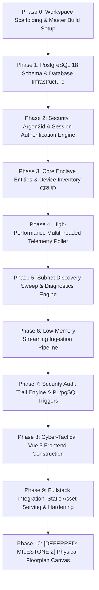

# Network Observer — Project Implementation Roadmap & Phased Execution Plan
**Document Version:** 2.1  
**Classification:** Restricted — Air-Gapped Industrial Enclave (SCADA / NOC Deployment)  
**Authoritative Status:** Mandatory Engineering Implementation Roadmap & Single Source of Truth  
**Target Workspace:** `d:\FullStackProjects\Network monitor`  
**Referenced Specifications:**
* Master SRS: [`master_software_requirements_specification.md`](file:///d:/FullStackProjects/Network%20monitor/master_software_requirements_specification.md)
* Database DDL & Ingestion: [`database_schema_and_ingestion_specification.md`](file:///d:/FullStackProjects/Network%20monitor/database_schema_and_ingestion_specification.md)
* REST API Contracts: [`api_contracts_specification.md`](file:///d:/FullStackProjects/Network%20monitor/api_contracts_specification.md)
* Security & RBAC: [`security_and_rbac_specification.md`](file:///d:/FullStackProjects/Network%20monitor/security_and_rbac_specification.md)
* Cyber-Tactical UI/UX Guidelines: [`ui_guidelines_and_design_system.md`](file:///d:/FullStackProjects/Network%20monitor/ui_guidelines_and_design_system.md)
* Project Requirements: [`project_requirements_document.md`](file:///d:/FullStackProjects/Network%20monitor/project_requirements_document.md)
* Living Progress Tracker: [`progress_tracker.md`](file:///d:/FullStackProjects/Network%20monitor/progress_tracker.md)

---

## 1. Executive Summary & Phased Delivery Strategy

This document establishes the authoritative step-by-step implementation roadmap for **Network Observer**. It translates all architectural specifications, data contracts, and security rules into **10 sequential, goal-backward engineering phases**.

### Core Governance Directives
1. **Document First, Code Second**: No code is written without a corresponding task defined in this roadmap and traced back to the master specification suite.
2. **Proper Fullstack Monolith**: The application is structured and deployed as a cohesive single-server fullstack platform (C++ Crow backend serving the Vue 3 `/dist` web application on port `8443`).
3. **Memory-First Engineering**: Every backend file operation and frontend data store must enforce the memory-bounding mandates ($< 15\text{ MB}$ RSS backend streaming, $< 60\text{ MB}$ JS heap frontend).
4. **Zero Shell Execution**: All ICMP echo and NTP checks must operate via native OS sockets; subprocess spawning is strictly prohibited.
5. **Mandatory Step-by-Step Verification Protocol**: Every engineering step is atomic and verifiable. No task or phase is marked complete, and execution will not advance to the next step, until concrete verification proof (terminal commands, compilation logs, curl/HTTP responses, test suites, or UI checks) is executed, demonstrated, and approved by the user.

---

## 2. High-Level Phase Overview

---

## 3. Detailed Phase Breakdown & Engineering Steps

---

### Phase 0: Workspace Scaffolding & Master Build Pipeline
* **Goal**: Establish the unified fullstack directory structure, build scripts, and local developer environment.
* **Target Architecture**:
  * Root CMake master build configuration.
  * `/backend`: C++20 Crow server project (`CMakeLists.txt`, headers, source tree).
  * `/frontend`: Vue 3 + Vite + Tailwind CSS project (`package.json`, `vite.config.ts`, `src/`).
  * `.gitignore` configured to ignore build artifacts, CMake caches, node_modules, and local test databases.
* **Key Steps**:
  1. Initialize Git repository (`git init`) and commit baseline documentation.
  2. Create comprehensive `.gitignore` for C++ (MSVC / CMake), Node/Vite (`dist`, `node_modules`), and PostgreSQL dumps.
  3. Scaffold backend directories:
     * `/backend/src/api`: Crow route controllers.
     * `/backend/src/db`: `libpqxx` connection pool and query helpers.
     * `/backend/src/poller`: Multithreaded ICMP/NTP socket engine.
     * `/backend/src/security`: Argon2id hasher, CSPRNG session store, RBAC middleware.
  4. Scaffold frontend directories:
     * `/frontend/src/components`: UI components (HUD, Topology, Inspector, Tables).
     * `/frontend/src/stores`: Pinia state stores with `shallowRef`.
     * `/frontend/src/views`: Main dashboard views.
  5. Configure CMake to download/integrate header-only dependencies:
     * `Crow` (HTTP/REST framework).
     * `nlohmann/json` (Modern C++ JSON).
     * `Boost.Asio` (Asynchronous I/O core).
  6. Configure Vite dev server with proxying:
     * Proxy `/api` requests to `http://localhost:8443`.
* **Deliverables**: Working unified build system where `npm run dev` boots the frontend and CMake compiles the backend.

---

### Phase 1: PostgreSQL 18 Database Engine & 3NF Schema Initialization
* **Goal**: Instantiate the Level 3 Normalized (3NF) relational database schema, declarative time-series range partitioning, and baseline seed data.
* **Specification Source**: [`database_schema_and_ingestion_specification.md` § 4](file:///d:/FullStackProjects/Network%20monitor/database_schema_and_ingestion_specification.md#L111)
* **Key Steps**:
  1. Author idempotent SQL schema migration scripts (`001_initial_schema.sql`):
     * Create tables: `sites`, `groups`, `device_types`, `devices`, `monitoring_config`, `reachability_status_types`, `health_status_types`, `disk_volume_samples`, `roles`, `users`, `audit_logs`, `import_batches`, `staged_devices`.
  2. Implement Declarative Range Partitioning:
     * Partition `reachability_samples` by `recorded_at` (`TIMESTAMPTZ`).
     * Partition `health_samples` by `recorded_at` (`TIMESTAMPTZ`).
     * Pre-seed default catch-all partitions (`reachability_samples_default`, `health_samples_default`).
  3. Author PL/pgSQL Immutability Triggers:
     * Implement `fn_audit_logs_immutable()` preventing `UPDATE` and `DELETE` on `audit_logs`.
  4. Pre-seed Master Enclave Data:
     * `sites`: Default Site 1 (`Primary Site Enclave`).
     * `groups`: Reserved Group 1 (`Unassigned Group`).
     * `roles`: 1 (`NETWORK_ADMIN`), 2 (`NETWORK_ENGINEER`), 3 (`IT_SUPPORT`).
     * `device_types`: 1 (`CORE_ROUTER`), 2 (`AGGREGATE_SWITCH`), 3 (`ACCESS_SWITCH`), 4 (`SERVER`), 5 (`PC`).
     * `monitoring_config`: Singleton Row 1 (5s reachability, 30s health, 2000ms timeout, cascade suppression TRUE).
     * Initial Network Admin account with default Argon2id password hash.
  5. Implement C++ `DatabasePool` class using `libpqxx`:
     * Thread-safe connection pool with configurable min/max connections.
     * Automatic startup migration checker (verifies database schema on boot).
* **Deliverables**: Verified PostgreSQL database with 100% 3NF schema, declarative time-series partitions, and immutable triggers.

---

### Phase 2: Security, Argon2id & Session Authentication Engine
* **Goal**: Build the secure authentication pipeline, cryptographic session manager, and RBAC route guard middleware in C++.
* **Specification Source**: [`security_and_rbac_specification.md`](file:///d:/FullStackProjects/Network%20monitor/security_and_rbac_specification.md) & [`api_contracts_specification.md` § 3](file:///d:/FullStackProjects/Network%20monitor/api_contracts_specification.md#L30)
* **Key Steps**:
  1. Implement Argon2id Password Cryptography:
     * C++ wrapper around `libsodium` / `argon2` implementing RFC 9106.
     * Parameters: $m=65,536\text{ KiB}$, $t=3\text{ passes}$, $p=4\text{ threads}$, $T=32\text{ bytes}$, $S=16\text{ bytes}$.
     * Constant-time password verification (`CRYPTO_MEMCMP`).
     * Dummy hashing pass on inactive accounts (`is_active = false`).
  2. Implement Cryptographic Session Manager:
     * 256-bit CSPRNG token generator (`BCryptGenRandom` on Windows / `getrandom` on Linux).
     * In-memory thread-safe session store with fast token lookup (`std::unordered_map` with `std::shared_mutex`).
     * Session lifecycle: 8-hour shift lifetime, 30-minute idle inactivity timeout.
     * Immediate revocation on logout, password change, or admin deactivation.
  3. Implement Crow RBAC Guard Middleware:
     * Intercepts all incoming requests.
     * Extracts session from `observer_session` cookie or `Authorization: Bearer` header.
     * Enforces the [Master Route Authorization Matrix](file:///d:/FullStackProjects/Network%20monitor/security_and_rbac_specification.md#L100): returns `401 Unauthorized` for missing/expired session, `403 Forbidden` for role violations.
  4. Implement Authentication API Endpoints:
     * `POST /api/v1/auth/login`: Authenticates credentials; returns numeric `role_id` and `site_id`; sets `HttpOnly; Secure; SameSite=Strict` cookie.
     * `POST /api/v1/auth/logout`: Invalidates session token immediately (`204 No Content`).
     * `GET /api/v1/auth/me`: Returns operator profile, role ID, and site ID.
     * `PUT /api/v1/auth/password`: Validates current password and updates hash with Argon2id.
  5. Implement User Administration API (Admin Only):
     * `GET /api/v1/users`: Returns tabular operator list with string `role` and `site_name`.
     * `POST /api/v1/users`: Pre-provisions new user (Zero Self-Registration enforced).
     * `GET /api/v1/users/{id}` & `PUT /api/v1/users/{id}`: Profile updates & admin password reset.
     * `DELETE /api/v1/users/{id}`: Safe deactivation; self-deletion blocked (`409`).
* **Deliverables**: End-to-end authenticated API with Argon2id hashing, secure cookies, and strict role enforcement.

---

### Phase 3: Core Enclave Entities & Device Inventory CRUD
* **Goal**: Implement the operational site metadata, nested group hierarchy, device inventory management, and global polling configuration.
* **Specification Source**: [`api_contracts_specification.md` § 4, 5, 7](file:///d:/FullStackProjects/Network%20monitor/api_contracts_specification.md)
* **Key Steps**:
  1. Enclave Site API:
     * `GET /api/v1/site`: Returns single site record (`site_id = 1`).
     * `PUT /api/v1/site`: Admin-only update of site name, code, contact info.
  2. Nested Group & Subgroup Hierarchy API:
     * `GET /api/v1/groups`: Builds nested tree format using **`children: [...]`** attribute; leaf groups return empty list `[]`.
     * `POST /api/v1/groups`: Creates new group or subgroup.
     * `PUT /api/v1/groups/{id}`: Renames/moves group (Group 1 protected).
     * `DELETE /api/v1/groups/{id}`: Reassigns orphaned devices and subgroups to `group_id = 1` (Unassigned Group).
  3. Device Inventory CRUD API:
     * `GET /api/v1/devices`: Paginated device records with search and group filtering.
     * `POST /api/v1/devices`: Provisions new device with strict 10-column schema mapping.
     * `GET /api/v1/devices/{id}`: Returns complete single device profile.
     * `PUT /api/v1/devices/{id}`: Updates mutable attributes; rejects MAC changes with `422 DEVICE_MAC_IMMUTABLE`.
     * `DELETE /api/v1/devices/{id}`: Orphan-safe deletion; safely sets `parent_device_id = NULL` on child devices.
  4. Global Monitoring Configuration API (Option 1):
     * `GET /api/v1/monitoring/config`: Returns global polling engine parameters.
     * `PUT /api/v1/monitoring/config`: Admin-only update of ICMP and health polling cadences.
* **Deliverables**: Complete inventory CRUD with locked MACs, orphan-safe cascades, and nested group tree serialization.

---

### Phase 4: High-Performance Multithreaded Telemetry Poller
* **Goal**: Build the 24/7 background telemetry daemon running native raw ICMP socket checks, UDP NTP drift calculations, and host health monitoring.
* **Specification Source**: [`master_software_requirements_specification.md` § 5.4–5.6](file:///d:/FullStackProjects/Network%20monitor/master_software_requirements_specification.md)
* **Key Steps**:
  1. Native Windows/Linux Raw Socket ICMP Engine (Zero Shell Spawning):
     * Uses Windows `IcmpSendEcho` API (or Linux `SOCK_RAW`) directly in C++.
     * Sub-millisecond round-trip latency (`latency_us`) and rolling packet loss calculation.
     * Strict N/A Rule: Timed-out or unreachable checks write `NULL` to `latency_us`, never zero.
  2. High-Precision UDP NTP Clock Drift Worker:
     * Constructs and parses raw 48-byte UDP NTP packets on port 123.
     * Measures microsecond clock offset (`ntp_offset_us`); writes `NULL` on timeout.
  3. Cascading Failure Suppression Circuit:
     * Maintains an in-memory adjacency tree of switch-to-device uplinks.
     * When an upstream Access Switch fails ICMP checks, downstream child devices are automatically marked `status_id = 3 (SUPPRESSED)`.
     * Synthetic ICMP pings to suppressed children are halted immediately, eliminating alert storms.
  4. Host Operating Health Collector (30s Cadence):
     * Queries host agents on port `9182` (or SNMP on switches) every 30 seconds.
     * Parses CPU %, RAM %, network throughput (Kbps), hardware temperature, and normalized multi-volume disk storage partitions (`C:`, `D:`, `/var`).
  5. Micro-Batch Database Ingestion Engine:
     * Batches ICMP results into 1-second micro-transactions, preventing database write-lock contention.
     * Inserts into range-partitioned `reachability_samples` and `health_samples`.
  6. Topology & Telemetry API Endpoints:
     * `GET /api/v1/topology`: Returns 2-branch logical tree and top HUD summary counters.
     * `GET /api/v1/telemetry/{id}`: Returns live slide-over inspector telemetry.
     * `GET /api/v1/telemetry/{id}/history`: Returns historical time-series latency samples.
* **Deliverables**: High-throughput 24/7 polling daemon with cascading suppression and micro-batch PostgreSQL persistence.

---

### Phase 5: Subnet Discovery Sweep & Operational Diagnostics
* **Goal**: Build the asynchronous subnet discovery worker and device maintenance mode toggling engine.
* **Specification Source**: [`api_contracts_specification.md` § 8](file:///d:/FullStackProjects/Network%20monitor/api_contracts_specification.md#L941)
* **Key Steps**:
  1. Asynchronous Subnet Discovery Worker:
     * `POST /api/v1/discovery/scan`: Accepts target CIDR (`192.168.1.0/24`), SNMP community, and version.
     * Validates CIDR constraint: Restricts sweep to max `/24` (254 hosts) with 10ms packet pacing to protect industrial PLCs.
     * Concurrency cap: Enforces max 1 concurrent scan per site (`409 Conflict`).
     * Asynchronously pings subnet IPs, queries ARP cache for MAC addresses, and interrogates SNMP bridges.
     * Inferred asset typing heuristics: Classifies discovered assets based on MAC OUI and open ports.
  2. Discovery Status & Discovered Assets API:
     * `GET /api/v1/discovery/scan/{scan_id}`: Polls scan progress percentage and discovered assets list.
  3. Operational Maintenance Mode Engine:
     * `PUT /api/v1/devices/{id}/maintenance`: Toggles `devices.is_monitored`.
     * Sets reachability status to slate-gray `UNKNOWN`.
     * Suppresses downstream cascade alerts.
     * RBAC check: `IT_SUPPORT` can toggle maintenance strictly on leaf endpoints (`type_id` not in `{1, 2, 3}`).
     * Records maintenance reason in `audit_logs`.
* **Deliverables**: Async subnet discovery scanner and maintenance mode controller.

---

### Phase 6: Low-Memory Streaming Bulk Ingestion Pipeline
* **Goal**: Build the zero-RAM-spike bulk file upload, persistent database staging, and atomic commit gatekeeper.
* **Specification Source**: [`database_schema_and_ingestion_specification.md` § 6](file:///d:/FullStackProjects/Network%20monitor/database_schema_and_ingestion_specification.md#L518) & [`api_contracts_specification.md` § 9](file:///d:/FullStackProjects/Network%20monitor/api_contracts_specification.md#L1020)
* **Key Steps**:
  1. Zero-RAM-Spike Streaming Multipart Upload Handler:
     * `POST /api/v1/ingest/upload`: Accepts CSV/SQLite file uploads up to 20MB.
     * Spools file through a fixed **64 KB ring buffer** in RAM.
     * Tokenizes rows using `std::string_view` with zero heap allocation per row.
     * Streams rows directly into `staged_devices` via `libpqxx::stream_to` (PostgreSQL binary `COPY FROM STDIN` protocol).
     * Bounded to **$< 15\text{ MB}$ RSS memory**.
  2. Automated Pre-Resolution Engine:
     * Resolves raw parent IP/MAC strings to existing `parent_device_id`.
     * Resolves nested group paths to `group_id`.
     * Flags rows: `VALID`, `INCOMPLETE` (missing MAC), or `CONFLICT` (duplicate IP/MAC).
  3. Staging Batches & Keyset Paginated Grid API:
     * `GET /api/v1/ingest/batches`: Lists staging batches.
     * `GET /api/v1/ingest/batches/{id}/records`: Keyset paginated (`LIMIT 50`) retrieval of staged records.
  4. Inline Cell Edit Engine:
     * `PUT /api/v1/ingest/records/{id}`: Updates unvalidated cells and re-evaluates validation state.
  5. Atomic Bulk Commit Gatekeeper (Admin Only):
     * `POST /api/v1/ingest/batches/{id}/commit`: Commits valid staged records into `devices` within an ACID transaction.
     * Supports `commit_valid_only: true` (valid committed, incomplete preserved in staging).
     * Rollback guarantee: Any constraint failure triggers a full `ROLLBACK`.
  6. Staging Batch Discard:
     * `DELETE /api/v1/ingest/batches/{id}`: Purges staged records and batch metadata.
* **Deliverables**: Streaming CSV ingestion pipeline with zero memory spikes and an admin-only commit gatekeeper.

---

### Phase 7: Security Audit Trail Engine & Non-Repudiation
* **Goal**: Integrate comprehensive audit logging across all state mutations, backed by tamper-proof PL/pgSQL database triggers.
* **Specification Source**: [`security_and_rbac_specification.md` § 8](file:///d:/FullStackProjects/Network%20monitor/security_and_rbac_specification.md#L320) & [`api_contracts_specification.md` § 11](file:///d:/FullStackProjects/Network%20monitor/api_contracts_specification.md#L1287)
* **Key Steps**:
  1. Central C++ Audit Logger:
     * Helper function `AuditLogger::log(user_id, action_code, entity_type, entity_id, details)` called on every state-changing route.
     * Standardized 20-event action code dictionary (`AUTH_LOGIN`, `DEVICE_CREATE`, `IP_UPDATE`, `BATCH_COMMIT`, etc.).
  2. Verification of Non-Repudiation Triggers:
     * Verify `trg_audit_logs_no_update` and `trg_audit_logs_no_delete` abort unauthorized modifications with database exceptions.
  3. Immutable Audit Log Query API (Admin Only):
     * `GET /api/v1/audit/logs`: Paginated log query with ISO 8601 date range, user ID, and action code filters.
* **Deliverables**: Immutable audit trail engine verifying complete operator traceability.

---

### Phase 8: Cyber-Tactical Vue 3 Frontend Construction
* **Goal**: Build the rich, high-density Cyber-Tactical SPA interface adhering to all UI guidelines and memory bounding directives.
* **Specification Source**: [`ui_guidelines_and_design_system.md`](file:///d:/FullStackProjects/Network%20monitor/ui_guidelines_and_design_system.md) & [`the_observer_tactical_spa.html`](file:///d:/FullStackProjects/Network%20monitor/the_observer_tactical_spa.html)
* **Key Steps**:
  1. Project Foundation & Cyber-Tactical Theme Setup:
     * Configure Tailwind CSS with custom palette (`#050811`, `#070b16`, cyan accents, amber alerts, red alarms).
     * Set up JetBrains Mono / Roboto Mono monospace typography tokens.
  2. Pinia Stores with Memory Optimization:
     * Implement stores using `shallowRef()` for inventory, staging records, and audit logs.
     * Guarantee flat browser JS heap memory ($< 60\text{ MB}$).
  3. Pre-Dashboard Login Portal:
     * Cyber-tactical authentication screen with enclave status pill and error handling.
  4. Top Critical Metric HUD Banner:
     * 5 tactical summary cards (Total Up, Down/Outage, Suppressed, High CPU >80%, High RAM >80%).
  5. Logical Topology Canvas (Tab 1):
     * Interactive SVG/Canvas tree: Horizontal backbone (Router $\rightarrow$ Core $\rightarrow$ Access) + **vertical 2-branch parallel endpoint columns** under Access Switches.
     * Smooth pan and zoom controls.
     * Real-time node status badges (green, red, amber suppressed, slate gray unknown).
     * Node click opens slide-over inspector.
  6. Right Slide-Over Telemetry Inspector:
     * Decoupled network ICMP/NTP telemetry and host health metrics.
     * Real-time gauges for CPU %, RAM %, and normalized multi-volume disk storage partitions (`C:`, `D:`).
     * Historical latency sparkline chart.
  7. Standardized Tabular Registries with Tactical Pagination:
     * Device Inventory, Sites Management, Groups & Subgroups, and Audit Logs registries.
     * Standardized header "+" action button, inline edit/delete actions.
     * Tactical pagination footer (`[ 25 | 50 | 100 | 250 ]`, range counters, page pills).
  8. Interactive Staging Grid (Bulk Ingestion):
     * Spreadsheet-like grid with inline cell editing for incomplete/conflicting rows.
     * Batch commit modal with partial commit toggle.
  9. 1:1 Database Schema Modal Dialogs:
     * Create/Edit Device modal reflecting all 10 schema fields with locked MAC validation.
* **Deliverables**: Fully functional, silky-smooth Vue 3 Cyber-Tactical single-page application.

---

### Phase 9: Fullstack Integration, Unified Serving & Hardening
* **Goal**: Unify the C++ Crow backend and compiled Vue 3 frontend into a single cohesive runtime, verify air-gap compliance, and run end-to-end performance benchmarks.
* **Key Steps**:
  1. Unified Crow Static Serving:
     * Crow serves compiled `/frontend/dist` assets on root paths (`/`, `/assets/*`).
     * API requests route to `/api/v1/...`.
     * Single running server, single port (`8443`), zero CORS.
  2. Memory Benchmarking & Leak Verification:
     * Ingest a 10,000-row CSV file; verify backend RSS stays under $15\text{ MB}$.
     * Leave Vue 3 dashboard open under continuous 5s polling for 2 hours; verify browser JS heap stays under $60\text{ MB}$.
  3. Security & Air-Gap Verification:
     * Run browser network audit; verify zero external HTTP requests to external CDNs or endpoints.
     * Verify Argon2id verification timing immunity.
     * Verify raw socket ICMP execution with zero subprocess spawning.
* **Deliverables**: Production-ready, unified fullstack binary package.

---

### Phase 10: [DEFERRED: FUTURE DEVELOPMENT / MILESTONE 2] Physical Floorplan Canvas
* **Goal**: Implement physical architectural CAD floorplan blueprint rendering with spatial coordinate beacons.
* **Status**: Architectural data models and `/api/v1/layouts/...` contracts preserved in documentation; active execution deferred to Milestone 2.

---

## 4. Phase Verification Matrix

| Phase | Core Deliverable | Primary Acceptance Criteria |
| :---: | :--- | :--- |
| **0** | Scaffolding & Build | CMake builds C++ Crow; Vite runs Vue 3 with API proxying. |
| **1** | Database Schema | PostgreSQL 18 tables, declarative partitions, and PL/pgSQL triggers instantiated. |
| **2** | Security & Auth | Argon2id password verification, 256-bit CSPRNG sessions, RBAC route guard active. |
| **3** | Core Inventory CRUD | Groups nested with `children: []`, devices CRUD with locked MACs and orphan-safe delete. |
| **4** | Telemetry Poller | Native raw socket ICMP (5s), UDP NTP drift, cascading suppression, micro-batch writes. |
| **5** | Diagnostics & Sweep | Async `/24` subnet scan with packet pacing, maintenance mode toggle. |
| **6** | Streaming Ingestion | 64KB chunk buffer reading, direct `COPY FROM STDIN` streaming ($< 15\text{ MB}$ RSS), admin commit. |
| **7** | Security Audit Trail | Immutable audit log records created on all mutations; PL/pgSQL triggers block tampering. |
| **8** | Vue 3 Tactical UI | 2-branch topology tree, slide-over inspector, staging grid with `shallowRef` ($< 60\text{ MB}$ heap). |
| **9** | Unified Fullstack App | Single Crow executable serves UI and API on port 8443; zero external CDN calls; fully offline. |
| **10**| Physical Layouts | Deferred to Milestone 2. |
